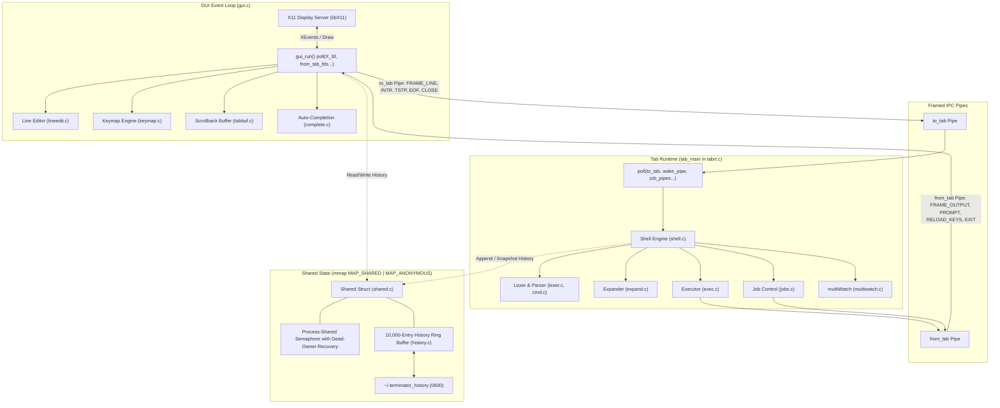

# Terminator: First-Principles Terminal Emulator & Shell

**Terminator** is an advanced terminal emulator and Unix shell written from first principles in C (`gnu11`) for Linux. It combines a custom Xlib-based graphical interface with a POSIX-compliant shell engine featuring multi-tab support, pipelines of arbitrary length, I/O redirection, asynchronous job control, persistent shared history, configurable keybindings, concurrent periodic monitoring (`multiWatch`), and Tab-key file-name auto-completion.

Terminator operates under strict systems engineering constraints: **zero third-party terminal or shell libraries** (no `readline`, `ncurses`, `GTK`, `Qt`, `Cairo`, `libvte`, `system()`, `popen()`, or delegating commands to `/bin/sh` or `/bin/bash`). Everything is implemented directly on top of POSIX system calls, the standard C library, `pthreads`, POSIX semaphores, `mmap`, and `libX11`.

---

## Table of Contents

1. [Key Features](#key-features)
2. [Architectural Overview](#architectural-overview)
   - [Dual Concurrency Models](#dual-concurrency-models)
   - [Framed Pipe IPC Protocol](#framed-pipe-ipc-protocol)
   - [Shared Memory & Multi-Tab Synchronization](#shared-memory--multi-tab-synchronization)
3. [Subsystem Deep Dive](#subsystem-deep-dive)
   - [1. Custom Xlib Terminal GUI](#1-custom-xlib-terminal-gui)
   - [2. Input Line Editor & Keymap Engine](#2-input-line-editor--keymap-engine)
   - [3. Shell Lexer, Completeness & Continuation](#3-shell-lexer-completeness--continuation)
   - [4. Six-Stage Expansion Pipeline](#4-six-stage-expansion-pipeline)
   - [5. Command Execution, Pipelines & Redirections](#5-command-execution-pipelines--redirections)
   - [6. Signals & Asynchronous Job Control](#6-signals--asynchronous-job-control)
   - [7. multiWatch Concurrent Periodic Runner](#7-multiwatch-concurrent-periodic-runner)
   - [8. Persistent Shared History & LCS Reverse Search](#8-persistent-shared-history--lcs-reverse-search)
   - [9. Tab-Key File-Name Auto-Completion](#9-tab-key-file-name-auto-completion)
4. [Built-in Commands](#built-in-commands)
5. [Default Keybindings Reference](#default-keybindings-reference)
6. [Repository Structure](#repository-structure)
7. [Building & Dependencies](#building--dependencies)
8. [Running Terminator](#running-terminator)
9. [Comprehensive Test Suite](#comprehensive-test-suite)
10. [Design Highlights & First-Principles Compliance](#design-highlights--first-principles-compliance)

---

## Key Features

- **Dual Interchangeable Runtimes**: Switch seamlessly between **Thread Mode** (one process, one POSIX thread per tab) and **Process Mode** (GUI parent, one forked process per tab with full crash isolation). Both modes achieve 100% behavioral parity over framed IPC pipes.
- **Pure Xlib GUI**: Double-buffered offscreen pixmap rendering eliminating visual flicker; dynamic tab bar with tab creation, switching, and closing; 10,000-line scrollback buffer with visual reflow; mouse wheel and keyboard scrolling; X11 `PRIMARY` and `CLIPBOARD` selection integration.
- **Robust POSIX Shell Core**: Hand-written lexer and parser; multi-line continuation prompt (`> `); full variable and environment expansion; command substitution (`$(cmd)` and `` `cmd` ``); recursive expansion up to depth 16; pathname globbing (`*`, `?`, `[...]`); and literal quoting (`'...'`, `"..."`, `\`).
- **Arbitrary Pipelines & Redirections**: Connect $N$ processes through $N-1$ pipes created with `pipe2(O_CLOEXEC)`; independent open file descriptions and offsets per child; full redirection support (`<`, `>`, `>>`, `2>`, `2>&1`) applied exclusively in forked children.
- **True Job Control & Signal Isolation**: Process group isolation (`setpgid`); interactive signal control via `Ctrl+C` (`SIGINT`) and `Ctrl+Z` (`SIGTSTP`); background execution (`&`); `jobs`, `fg`, and `bg` built-ins with job spec parsing (`%n`, `%+`, `%-`, `%%`); asynchronous child termination notification via `SIGCHLD` wake-pipe; protection against accidental exit with stopped jobs.
- **Concurrent `multiWatch`**: Run multiple commands in parallel periodically (`multiWatch -n <sec> ["cmd1", "cmd2", ...]`) with non-blocking monotonic deadline scheduling, atomic output framing with 52-character dash separators, and graceful two-stage signal teardown.
- **Persistent Shared History & Fuzzy Search**: 10,000-entry shared circular ring buffer in anonymous `mmap` with process-shared semaphores and dead-owner crash recovery; persistent file storage (`~/.terminator_history`) with atomic append writes and startup compaction; interactive `Ctrl+R` reverse search using dynamic programming Longest Common Substring (LCS) with $O(M)$ stack space executing in $< 5$ ms.
- **Intelligent Tab-Key Auto-Completion**: In-place filename auto-completion; quote and escape awareness; directory trailing slashes; Longest Common Prefix (LCP) completion; interactive numbered candidate selection mode (`"1. abc.txt 2. abcd.txt"`); threshold prompt for $> 100$ possibilities; automatic backslash escaping of shell metacharacters; zero GUI `chdir()`.
- **Zero Busy-Waiting**: Every wait in the GUI and backend is a blocking `poll()` driven by explicit file descriptor activity or monotonic clock deadlines. No `sleep()` loops, no spinning, and no CPU wastage.

---

## Architectural Overview

Terminator enforces a strict architectural boundary between the graphical interface and the shell backend:
- The **GUI** is the **only** subsystem that communicates with the X11 display server. It handles mouse and keyboard events, manages the input buffer, maintains the scrollback buffers, and renders pixels.
- The **Tab Core** runs `tab_main()`, which is entirely unaware of X11. It executes the shell runtime, maintains environment variables, tracks the current working directory (`cwd`), manages background jobs, and spawns child process pipelines.
- Communication between the GUI and each tab occurs exclusively over a pair of unidirectional IPC pipes (`to_tab`, `from_tab`) carrying framed binary messages.



### Dual Concurrency Models

Terminator supports two execution modes configured at launch:

1. **Thread Mode (`./terminator`)**:
   - The GUI runs on the main thread.
   - Each tab runs as a separate POSIX thread executing `tab_main(&chan)`.
   - IPC occurs over pipe pairs created with `pipe2(O_CLOEXEC)`.
   - Threads communicate cleanly without touching global mutable state; all shell data structures are dynamically allocated per tab.

2. **Process Mode (`./terminator useProcess=True`)**:
   - The GUI runs as a single-threaded parent process.
   - For every tab created, the GUI forks an independent child process.
   - The child immediately closes the X connection descriptor (`close(ConnectionNumber(dpy))`) and all file descriptors belonging to other tabs.
   - The child runs `tab_main(&chan)` and exits via `_exit()`.
   - **Fault Isolation**: If a tab process crashes or is terminated by `kill -9`, the GUI detects `POLLHUP`/`EOF` on its pipe, reaps the process via non-blocking `waitpid()`, marks only that tab dead, and continues running unaffected.

Both modes execute the **exact same** `tab_main()` entry point, ensuring zero logic divergence between threads and processes.

### Framed Pipe IPC Protocol

All communication between the GUI and tabs utilizes an explicit 5-byte binary header followed by a payload of up to 64 KiB:

```
+---------------+--------------------------------+--------------------------------+
|  Type (1 B)   |     Payload Length (4 B, LE)   |     Payload (0 .. 64 KiB)      |
+---------------+--------------------------------+--------------------------------+
```

#### Protocol Message Catalog:
| Direction | Frame Type | Opcode | Description |
|---|---|---|---|
| GUI $\to$ Tab | `FRAME_LINE` | `0x01` | Submits a completed input command line for execution. |
| GUI $\to$ Tab | `FRAME_INTR` | `0x02` | Delivers `SIGINT` / Ctrl+C to the active foreground job group. |
| GUI $\to$ Tab | `FRAME_TSTP` | `0x03` | Delivers `SIGTSTP` / Ctrl+Z to the active foreground job group. |
| GUI $\to$ Tab | `FRAME_EOF` | `0x04` | Delivers `EOF` (Ctrl+D) when the input line is empty. |
| GUI $\to$ Tab | `FRAME_CLOSE` | `0x05` | Instructs the tab backend to terminate cleanly. |
| GUI $\to$ Tab | `FRAME_RESIZE` | `0x06` | Informs the tab backend of terminal window dimension changes. |
| Tab $\to$ GUI | `FRAME_OUTPUT` | `0x10` | Stream of command stdout and stderr bytes to append to the scrollback buffer. |
| Tab $\to$ GUI | `FRAME_PROMPT` | `0x11` | Notifies GUI of tab's `cwd\0` followed by prompt text (`user@terminator> ` or `> `). |
| Tab $\to$ GUI | `FRAME_RELOAD_KEYS` | `0x12` | Signals the GUI to re-read keymap configurations from disk (`bind` command). |
| Tab $\to$ GUI | `FRAME_EXIT` | `0x13` | Notifies GUI that the tab shell has exited with status $N$. |

The GUI writes to tabs non-blockingly using a bounded circular `OutQueue` (`OUT_QUEUE_CAPACITY = 128 KiB`) and reads with an `InBuffer` that handles partial reads, fragmented frames, and boundary reassembly without blocking the event loop.

### Shared Memory & Multi-Tab Synchronization

Command history is synchronized across all tabs in both Thread and Process modes using an anonymous shared memory mapping:
- Created in `main()` prior to spawning any threads or processes via `mmap(MAP_SHARED | MAP_ANONYMOUS)`.
- Protected by a process-shared semaphore (`sem_init(&sh->sem, 1, 1)` on Linux, or process-shared mutex on macOS).
- **Dead-Owner Crash Recovery**: When acquiring the lock, `sh->owner_pid` records the holding process ID. If a process holding the lock crashes (`kill -9`), waiting tabs detect a lock timeout via `sem_timedwait()`, verify the owner is dead via `kill(owner_pid, 0) == ESRCH`, re-initialize the semaphore, and recover ownership safely without deadlocking.

---

## Subsystem Deep Dive

### 1. Custom Xlib Terminal GUI

The graphical interface is built directly on Xlib primitives without toolkit overhead:
- **Double-Buffered Backbuffer**: Allocates an offscreen `Pixmap` matching the window dimensions. All drawing operations (backgrounds, tab headers, scrollback text, cursor, selection highlights, scrollbar) render to the pixmap first, followed by a single `XCopyArea` call to the onscreen `Window` per event loop iteration, completely eliminating visual flicker.
- **Tab Strip**: Interactive tab bar rendering tab numbers, working directory labels, active tab indicators, hover states, individual tab close buttons (`x`), and a new tab button (`+`). Directory paths starting with `$HOME` are dynamically abbreviated using `~`.
- **Text Reflow & Scrollback Ring Buffer (`tabbuf.c`)**: Maintains a circular buffer of up to 10,000 logical lines. The renderer computes visual lines on the fly based on current window width (`cols = width / font_width`), allowing seamless text reflow upon window resize.
- **Mouse & Keyboard Scrolling**: Supports smooth mouse wheel scrolling (`Button4`/`Button5`) and keyboard scrolling (`Shift+PageUp`/`Shift+PageDown`) with visual scrollbar rendering. Typing any new command automatically snaps the view to the bottom.
- **X11 Selection Integration**:
  - Dragging with the left mouse button highlights text across visual rows and sets ownership of the X11 `PRIMARY` selection.
  - `Ctrl+Shift+C` copies selected text to the `CLIPBOARD` selection.
  - `Ctrl+Shift+V` and Middle Click (`Button2`) request selection data via `XConvertSelection` and insert pasted text directly into the live input buffer.

### 2. Input Line Editor & Keymap Engine

Line editing is completely decoupled from X11 into portable, unit-testable C modules:
- **Line Editor (`lineedit.c`)**: Fixed-capacity bounds-checked buffer (`LINEEDIT_MAX = 4096`) managing cursor positions, character/text insertions, backspace, forward delete, start/end navigation, kill-to-start (`Ctrl+U`), kill-to-end (`Ctrl+K`), and word deletion (`Ctrl+W`).
- **Range Replacement**: `lineedit_replace_range(le, start, end, repl)` replaces arbitrary spans in-place, shifts trailing text, and positions the cursor immediately following the replacement, enabling seamless auto-completion.
- **Configurable Keymap (`keymap.c`)**:
  - Parses key chord strings (e.g. `Ctrl+Shift+T`, `Alt+1`, `Up`, `Home`).
  - Detects duplicate chords and protects hard-reserved combinations (`Ctrl+C`, `Ctrl+Z`, `Ctrl+R`, `Tab`).
  - Loads and saves bindings to `~/.terminatorrc` atomically using temporary files and `rename()`.
  - The `bind` builtin updates the active keymap and emits `FRAME_RELOAD_KEYS` to the GUI.

### 3. Shell Lexer, Completeness & Continuation

- **Single-Pass Lexer (`lexer.c`)**: State machine scanning input text character-by-character into token streams: `TOK_WORD`, `TOK_PIPE`, `TOK_AMP`, `TOK_SEMI`, `TOK_LESS`, `TOK_GREAT`, `TOK_DGREAT`, and `TOK_NEWLINE`.
- **Segmented Words**: Words are represented as linked lists of `WordSegment` nodes tagged with quotation types: `QUOTE_NONE`, `QUOTE_SINGLE`, or `QUOTE_DOUBLE`.
  - Single quotes (`'...'`): Preserve all characters strictly verbatim.
  - Double quotes (`"..."`): Preserve literal spaces while enabling variable expansion, subshells, and backslash escape processing.
  - Outside quotes: Backslash escapes the next character.
- **Completeness Detection**:
  - `lex_check_completeness()` evaluates whether a command line is complete or requires continuation.
  - Returns `LEX_INCOMPLETE_*` when encountering unterminated single quotes, unterminated double quotes, trailing backslashes, open command substitutions (`$(` or `` ` ``), or trailing pipe operators (`|`).
  - On incomplete input, the tab shell replies with the continuation prompt `> ` and accumulates subsequent lines into a dynamically growing multiline buffer.
  - Backslash-newline sequences outside quotes are cleanly removed; newlines within quotes are preserved verbatim.
  - Multiline commands are stored in the history ring buffer as a single, atomic command line.

### 4. Six-Stage Expansion Pipeline

Before execution, words pass through an expansion pipeline matching standard shell behavior:


1. **Tilde Expansion**: `~` expands to `$HOME`; `~/path` resolves to `$HOME/path`. Non-existent user lookups or quoted tildes (`"~"`) are kept literal.
2. **Parameter Expansion**: Expands environment and local shell variables (`$VAR`, `${VAR}`), exit status of the previous command (`$?`), PID of the shell (`$$`), argument count (`$#`), and program name (`$0`).
3. **Command Substitution**: `$(command)` and `` `command` `` evaluate `command` inside an isolated forked subshell, capture stdout via pipe, wait for completion, and strip trailing newlines. Evaluated recursively up to depth 16 (`MAX_SUBST_DEPTH`).
4. **Pathname Globbing**: Unquoted wildcards (`*`, `?`, `[...]`) expand using `glob(3)` with `GLOB_NOCHECK`. Quoted patterns remain literal.
5. **Word Splitting**: Splits unquoted expansion results across whitespace boundaries into distinct arguments.
6. **Quote Removal**: Strips enclosing quote markers, yielding clean arguments for `execvp`.

### 5. Command Execution, Pipelines & Redirections

- **Pipeline Assembly (`exec.c`)**:
  - For a pipeline of $N$ commands, Terminator creates all $N-1$ pipes up front using `pipe2(pipes[i], O_CLOEXEC)`.
  - Forks $N$ child processes.
  - Process group isolation: All child processes in a pipeline join the process group of the first child (`setpgid(pid, pgid)` called in both parent and child).
  - Pipe plumbing: Stage $i$ connects its stdin to `pipes[i-1][0]` and its stdout to `pipes[i][1]`. The final stage directs stdout to the tab's output capture pipe.
  - **Immediate Parent Closure**: The parent closes all pipe ends immediately after forking all children. This prevents deadlocks and ensures readers receive `EOF` when writers terminate.
- **First-Principles I/O Redirection**:
  - Redirections (`<`, `>`, `>>`, `2>`, `2>&1`) are parsed into `Redir` structs and can appear anywhere in the command.
  - **Applied Exclusively in Children**: Redirections are evaluated in the child process after `setpgid`, signal resets, and pipeline `dup2`s.
  - Files are opened in the child via `open(path, flags, mode)` and attached using `dup2()`.
  - **Independent File Descriptions**: Each process opens its own files, guaranteeing independent file offsets so concurrent background jobs reading the same file never interfere.
- **Built-in Commands in Pipelines**:
  - When builtins appear inside a multi-stage pipeline (e.g. `history | grep gcc`), they execute inside a forked child process using raw file descriptor output sinks, ensuring process state mutations do not pollute the parent tab.
- **Pipeline Exit Status**: The exit status `$?` is set to the exit code of the **last command** in the pipeline.

### 6. Signals & Asynchronous Job Control

Terminator implements full terminal job control without a pty:
- **Process Group Signaling**: The GUI process and tab shell ignore terminal signals (`SIGINT`, `SIGQUIT`, `SIGTSTP`, `SIGTTIN`, `SIGTTOU`, `SIGPIPE`). Child processes restore all signals to `SIG_DFL` before executing.
- **Key Routing**:
  - Pressing `Ctrl+C` sends `FRAME_INTR`. If a foreground job is running, the tab shell sends `kill(-pgid, SIGINT)` to the job's process group, setting `$? = 130`.
  - Pressing `Ctrl+Z` sends `FRAME_TSTP`. The tab shell delivers `kill(-pgid, SIGTSTP)`, marks the job as `JOB_STOPPED`, prints `\n[id]+ Stopped <cmd>`, sets `$? = 148`, and re-prompts immediately.
- **Async Signal Safe Child Reaping**:
  - A global `SIGCHLD` handler executes an async-signal-safe single-byte `write(1)` to registered per-tab wake-pipes.
  - The tab's `poll()` loop detects wake-pipe activity and invokes `waitpid(pid, WNOHANG | WUNTRACED | WCONTINUED)` strictly on its own tracked PIDs. It never calls `waitpid(-1, ...)` or `wait()`, preventing tabs from stealing each other's children.
- **Job Management Builtins**:
  - `jobs`: Lists all running and stopped jobs with current (`+`) and previous (`-`) markers.
  - `fg [%id]`: Brings a background or stopped job to the foreground, sending `SIGCONT` if stopped, and waits for completion.
  - `bg [%id]`: Resumes a stopped job in the background with `SIGCONT`.
  - Background jobs (`cmd &`): Spawned directly in background process groups; completed jobs are announced once before the next prompt as `[id]+ Done <cmd>`.
- **Exit Protection**: Typing `exit` or `Ctrl+D` while stopped jobs exist warns the user (`There are stopped jobs.`) and aborts the exit. A second consecutive exit command forces termination.

### 7. multiWatch Concurrent Periodic Runner

The `multiWatch` subsystem runs multiple commands in parallel periodically without blocking:

```sh
multiWatch [-n <seconds>] ["cmd1", "cmd2", ...]
```

- **Dedicated Argument Parser**: Intercepts `multiWatch` commands before standard shell dispatch to parse bracketed lists, interval flags (`-n`), and quoted command strings.
- **Parallel Subshell Spawning**: Spawns all $N$ commands concurrently in separate processes using `pipe2(O_CLOEXEC)`. Each child establishes its own process group (`setpgid(0, 0)`), redirects stdout and stderr to its pipe, and runs the command through `shell_execute_subshell()`.
- **Monotonic Scheduling (Zero Busy-Waiting)**: The parent tab monitors all child pipes and its control pipe within a single `poll()` loop. The timeout is dynamically calculated as the minimum time until the next scheduled run:
  $$\Delta T = \min_{i} (T_{\text{next}, i} - T_{\text{now}})$$
  If a command takes longer than the interval to execute, it is rescheduled immediately upon completion.
- **Atomic Output Blocks**: Output is buffered per command (up to 1 MiB) and emitted to the GUI as an atomic, non-interleaved block formatted with timestamps and 52-character dash separators:
  ```
  "<command>", <unix_timestamp>:
  ----------------------------------------------------
  <command output>
  ----------------------------------------------------
  ```
- **Two-Stage Teardown**: Pressing `Ctrl+C` sends `SIGTERM` to all active child process groups. Any process surviving a 300 ms grace period is terminated with `SIGKILL`. All children are reaped cleanly, and the shell returns to the interactive prompt with status 130.

### 8. Persistent Shared History & LCS Reverse Search

Command history is shared across all tabs and persistent across sessions:
- **Circular Shared-Memory Ring**: 10,000 entries (`HISTORY_CAPACITY`) stored in anonymous shared memory. Slot size is 1,024 bytes; longer commands are cleanly truncated. Lookups by 64-bit sequence number run in $O(1)$ time.
- **Persistent Disk File (`~/.terminator_history`)**:
  - Permissions set to strict `0600` (`S_IRUSR | S_IWUSR`).
  - Multiline commands are encoded with escaped newlines (`\n`) and backslashes (`\\`) so every history entry occupies exactly one file line.
  - Every append operation performs a single `write()` opened with `O_WRONLY | O_CREAT | O_APPEND | O_CLOEXEC` while holding the shared lock, preventing torn lines between concurrent tabs.
  - **Zero-Contention Compaction**: If the history file grows beyond 20,000 lines, it is compacted atomically at startup under zero contention by writing the 10,000 newest entries to a temporary file (`.tmp.<pid>`) with `fsync()` and replacing via `rename()`.
- **Interactive Reverse Search (`Ctrl+R`)**:
  - Modal search UI prompt: `Enter search term: `.
  - Evaluates search terms using a dynamic programming **Longest Common Substring (LCS)** algorithm with two alternating rolling rows ($O(M)$ space, where $M \le 256$).
  - Searches 10,000 full entries in $< 4$ ms, well below the 50 ms interactive threshold.
- **Search Decision Hierarchy**:
  1. **Rule (a) - Exact Match**: Scans newest to oldest. If an exact match is found (`strcmp == 0`), returns only that single most recent command.
  2. **Rule (b) - Substring Match with Ties**: If no exact match exists, calculates the longest common contiguous substring across all entries. If the maximum length is $> 2$ characters, returns all commands tied for the maximum length, newest first, with duplicate lines eliminated.
  3. **Rule (c) - No Match**: Outputs `No match for search term in history`.

### 9. Tab-Key File-Name Auto-Completion

Auto-completion is implemented entirely GUI-side in response to `XK_Tab`:
- **Word Boundary Extraction**: Finds the word ending at the cursor, correctly splitting on unescaped whitespace while honoring quoted strings and backslash-escaped characters (`cat my\ file.txt`). All text before the word and after the cursor is preserved byte-for-byte.
- **Per-Tab CWD Binding (Zero GUI `chdir`)**: Resolves candidate files relative to the active tab's `cwd` (reported by `FRAME_PROMPT`). The GUI never calls `chdir()`.
- **Directory Filtering & Sorting**: Reads directories via `opendir()`/`readdir()`. Skips `.` and `..`; hides dotfiles unless the prefix starts with `.`; probes entries via `stat()` to append a trailing `/` to directories; and sorts candidates alphabetically with `strcmp`.
- **Longest Common Prefix (LCP)**: Computes the common prefix of sorted candidates in $O(\text{len})$ time and $O(1)$ space by comparing the first and last array elements.
- **Multi-Stage Disambiguation**:
  - **1 Match**: Immediately completes the word (adds `/` for directories, nothing else).
  - **Multiple Matches ($\text{LCP} > \text{typed}$)**: Extends the typed word to the LCP.
  - **Ambiguous Matches ($\text{LCP} == \text{typed}$)**:
    - If $> 100$ possibilities: Prompts `Display all N possibilities? (y or n)`.
    - Formats candidates into a multi-column numbered list (`"1. abc.txt  2. abcd.txt"`) wrapped to terminal width.
    - Commits the numbered list to scrollback, re-shows the prompt with the input line, and enters selection mode (`COMPL_STATE_SELECT`).
    - Key handling in selection mode: Digits accumulate; `Enter` confirms and inserts the selected candidate without executing the command; `Esc` or any non-digit key cancels and leaves the input line unchanged.
- **Automatic Metacharacter Escaping**: Filenames containing spaces, quotes, or shell metacharacters (`$`, `&`, `|`, `;`, `<`, `>`, `*`, `?`, etc.) are automatically escaped with backslashes upon insertion. Trailing directory slashes remain unescaped to allow continuous path traversal.

---

## Built-in Commands

Terminator implements the following built-in commands directly in the shell core:

| Command | Syntax | Description |
|---|---|---|
| `cd` | `cd [dir]` | Change tab working directory. Supports `~`, `-` (previous directory), and error reporting. |
| `pwd` | `pwd` | Print current working directory. |
| `echo` | `echo [-n] [-e] [args...]` | Print arguments. `-n` suppresses newline; `-e` interprets backslash escapes. |
| `history` | `history [n]` | Display command history with sequence numbers (default: last 1,000 entries). |
| `export` | `export [VAR[=val]...]` | Set environment variables exported to child processes, or list all exported variables. |
| `unset` | `unset [VAR...]` | Remove shell and environment variables. |
| `jobs` | `jobs` | List active background and stopped jobs with job IDs and `+`/`-` markers. |
| `fg` | `fg [%job_id]` | Bring a background or stopped job into the foreground. |
| `bg` | `bg [%job_id]` | Resume a stopped job in the background with `SIGCONT`. |
| `bind` | `bind [action chord \| reset action]` | List, rebind, or reset GUI keybindings in `~/.terminatorrc`. |
| `multiWatch` | `multiWatch [-n sec] ["cmd1", ...]` | Run commands in parallel periodically until Ctrl+C. |
| `clear` | `clear` | Clear the active tab screen and scrollback buffer (equivalent to `Ctrl+L`). |
| `exit` | `exit [status]` | Exit the active tab shell (warns if stopped jobs exist). |

---

## Default Keybindings Reference

All keybindings (except hard-reserved system shortcuts) are user-rebindable via the `bind` command:

| Key Shortcut | Action Name | Description |
|---|---|---|
| `Tab` | `tab_complete` | Complete filename at cursor, extend to LCP, or open numbered selection |
| `Ctrl+Shift+T` / Click `+` | `spawn_tab` | Open a new tab |
| `Ctrl+Shift+W` / Click `x` | `close_tab` | Close the active tab |
| `Alt+1` .. `Alt+9` | `switch_tab` | Switch directly to tabs 1 through 9 |
| `Ctrl+PageUp` / `Ctrl+PageDown`| `prev_tab` / `next_tab` | Switch to previous / next tab |
| `Shift+PageUp` / `Shift+PageDn`| `scroll_page_up` / `down` | Scroll scrollback buffer up / down by visible page |
| `Mouse Wheel Up` / `Down` | (mouse scroll) | Scroll terminal buffer up / down 3 lines |
| `Left Drag` | (select text) | Highlight text across terminal and copy to `PRIMARY` |
| `Ctrl+Shift+C` | `copy` | Copy highlighted text to `CLIPBOARD` selection |
| `Ctrl+Shift+V` / Middle Click | `paste` | Paste text from `CLIPBOARD` / `PRIMARY` into live input line |
| `Enter` | `return` | Submit command line (or confirm selection in modal modes) |
| `Ctrl+R` | `search` | Open reverse history search prompt (`Enter search term: `) |
| `Esc` | (cancel) | Cancel history search or completion selection mode |
| `Ctrl+C` | (system signal) | Send `SIGINT` to foreground job group, cancel search, or abort multiline input |
| `Ctrl+Z` | (system signal) | Send `SIGTSTP` to foreground job group and stop job |
| `Ctrl+A` / `Home` | `line_start` | Move cursor to beginning of line |
| `Ctrl+E` / `End` | `line_end` | Move cursor to end of line |
| `Ctrl+U` | `kill_to_start` | Delete text from cursor to start of line |
| `Ctrl+K` | `kill_to_end` | Delete text from cursor to end of line |
| `Ctrl+W` | `delete_prev_word` | Delete word before cursor |
| `Ctrl+L` | `clear_screen` | Clear visible terminal screen and redraw prompt |
| `Ctrl+D` | `eof` | Empty line: send EOF (close tab / stdin); Non-empty: delete char |
| `Up` Arrow | `history_prev` | Browse older history command (saves in-progress input) |
| `Down` Arrow | `history_next` | Browse newer history command (restores in-progress input) |
| `Left` / `Right` Arrow | `move_left` / `move_right` | Move cursor within input line |
| `Backspace` | `backspace` | Delete character before cursor |
| `Delete` | `delete` | Delete character under cursor |

---

## Repository Structure

```
terminator/
├── Makefile                    # Standard and debug build targets (ASan + UBSan)
├── README.md                   # Comprehensive architectural guide and documentation
├── AGENTS.md                   # First-principles rules and system specifications
├── docs/
│   └── DESIGN.md               # In-depth engineering design and subsystem specifications
├── src/
│   ├── main.c                  # Program entry point, signal setup, runtime bootstrap
│   ├── proto.h / proto.c       # Framed binary IPC protocol encoder, decoder, queues
│   ├── shared.h / shared.c     # Anonymous mmap shared memory and process-shared semaphore
│   ├── history.h / history.c   # 10,000-entry history ring, persistence, LCS search
│   ├── lineedit.h / lineedit.c # X-free input buffer, cursor manipulation, visual reflow
│   ├── keymap.h / keymap.c     # Configuration parser, chord resolver, ~/.terminatorrc
│   ├── tabbuf.h / tabbuf.c     # 10,000-line scrollback buffer, visual line reflow
│   ├── tabrt.h / tabrt.c       # Thread/process tab runtime manager and tab_main loop
│   ├── complete.h / complete.c # Word extraction, LCP algorithm, candidate gathering
│   ├── gui.h / gui.c           # Pure Xlib window, event loop, double-buffered renderer
│   ├── syscompat.h             # Portable pipe2 emulation for macOS development
│   └── shell/
│       ├── shell.h / shell.c   # Shell state, environment synchronization, dispatch
│       ├── lexer.h / lexer.c   # Single-pass state machine lexer and completeness check
│       ├── cmd.h / cmd.c       # Pipeline and redirection parser
│       ├── expand.h / expand.c # 6-stage expansion pipeline (tilde, vars, subshell, glob)
│       ├── exec.h / exec.c     # Pipeline execution, pipe wiring, child redirection
│       ├── jobs.h / jobs.c     # Process group job control, signal handling, specs
│       ├── builtins.h / builtins.c # Shell built-in command implementations
│       ├── multiwatch.h / multiwatch.c # Concurrent periodic command monitor
│       ├── sink.h / sink.c     # Output sink abstractions (framed IPC vs raw fd)
│       └── vars.h / vars.c     # Variable table with status ($?), PID ($$), envp sync
└── tests/
    ├── harness.c               # 14-part comprehensive headless integration test suite
    ├── check_x.c               # X11 server accessibility probe
    ├── smoke_gui.sh            # Automated CLI and GUI smoke test runner
    └── sample.terminatorrc     # Example keymap configuration file
```

---

## Building & Dependencies

### Prerequisites

- **Linux (Ubuntu / Debian)**:
  ```bash
  sudo apt update
  sudo apt install build-essential pkg-config libx11-dev xvfb xdotool
  ```
- **macOS (Development & Headless Testing)**:
  ```bash
  brew install libx11 pkg-config
  ```

### Build Commands

- **Optimized Release Binary**:
  ```bash
  make
  ```
  Compiles `terminator`, `test_harness`, and `test_check_x` with `-std=gnu11 -Wall -Wextra -Wpedantic -O2 -g`.

- **Debug Binary with AddressSanitizer & UndefinedBehaviorSanitizer**:
  ```bash
  make debug
  ```
  Enables `-fsanitize=address,undefined -fno-omit-frame-pointer` to guarantee memory safety and detect undefined behaviors.

- **Clean Build Artifacts**:
  ```bash
  make clean
  ```

---

## Running Terminator

### 1. Thread Mode (Default)
```bash
./terminator
```
Launches Terminator with one POSIX thread per tab.

### 2. Process Mode
```bash
./terminator useProcess=True
```
Launches Terminator with one forked process per tab, providing complete process and memory isolation.

### Color Theme Configuration
Terminator supports dark (default) and light themes via the `TERMINATOR_THEME` environment variable:
```bash
# Launch with dark theme (default)
./terminator

# Launch with light theme
TERMINATOR_THEME=light ./terminator
```

---

## Comprehensive Test Suite

Terminator features an exhaustive, headless integration test harness (`tests/harness.c`) validating all subsystems without requiring an active X11 display server:

```bash
./test_harness
```

### Test Coverage Highlights:
- **Part 0: Expansion Pipeline**: Tilde expansion, parameter expansion, recursive command substitutions, quoting, word splitting, pathname globbing.
- **Part 1: Shell Core & Builtins**: Built-in `echo (-n, -e)`, `cd`, `pwd`, `cd -`, error handling, external `execvp`, unknown commands ($?=127), permission denied ($?=126).
- **Part 2: Multiline Input & Continuation**: Multiline quoting, command substitutions spanning lines, continuation abort via Ctrl+C, single-entry history storage.
- **Part 3: Multi-Tab Isolation Proof**: Thread-mode isolation verifying that `cd` in Tab 1 does not affect Tab 2, and verifying shared history visibility across tabs.
- **Part 4: Process Mode Execution**: Process mode tab creation, execution of complex pipelines, and clean process reaping.
- **Part 5: Tab Runtime Integration**: Spawning, lifecycle management, and closing of tabs via `tabrt_spawn` and `tabrt_close`.
- **Part 7: I/O Redirection**: Redirection parsing, stdout (`>`), stdin (`<`), both together, append (`>>`), error redirection (`2>`, `2>&1`), built-in redirection, concurrent readers of the same file with independent offsets.
- **Part 8: Arbitrary Pipelines**: Multi-stage pipelines (e.g. `ls | sort | head -5`), high throughput data streaming (`200,000` numbers), `SIGPIPE` termination, failing middle stages, zero file descriptor leaks across 500 consecutive pipelines.
- **Part 10: multiWatch**: Dedicated bracket parser, parallel command execution, inner pipelines, failed command captures, 1 MiB output truncation, two concurrent tabs with isolated Ctrl+C teardown.
- **Part 11: Keymap & Line Editor**: Pure C lineedit unit tests, key chord parsing, conflict detection, persistent configuration serialization, sequence-based history navigation.
- **Part 12: Signals & Job Control**: Foreground Ctrl+C (`SIGINT`), Ctrl+Z (`SIGTSTP`), job table status tracking, `jobs`, `fg`, `bg`, job spec resolution, background jobs (`&`), exit warning on stopped jobs, tab signal isolation.
- **Part 13: Persistent Shared History**: Dynamic programming LCS algorithm, multiline encoding/decoding, atomic startup compaction, stress testing (8 concurrent threads/processes $\times$ 5,000 appends), dead-owner crash recovery (`kill -9` holding lock), 10,000-entry search benchmark ($< 5$ ms).
- **Part 14: Tab-Key Auto-Completion**: Word extraction, word decomposition, filename escaping/unescaping, LCP calculation, candidate gathering, dotfile hiding, spec transcript reproduction, per-tab CWD isolation, 5,000-file benchmark ($< 2.5$ ms).
- **Part 6: Random Byte Fuzzer**: 5-second random byte fuzzer generating $> 500,000$ iterations against the shell lexer and parser with zero crashes or memory faults.

### Automated Test Runner
```bash
make test
```
Executes CLI argument validation, runs the full headless harness, checks for X11/Xvfb availability, and runs automated GUI smoke tests under virtual display buffers.

---

## Design Highlights & First-Principles Compliance

1. **Zero Disallowed Libraries**: No `readline`, `ncurses`, `GTK`, `Qt`, `Cairo`, `libvte`, `system()`, or `popen()`. Built purely with standard POSIX system calls and Xlib.
2. **Absolute Process Isolation**:
   - `chdir()`, `setenv()`, and `dup2()` are process-wide. In the shell core, they are **never** called in the tab context; they execute strictly within forked children prior to `execvp`.
   - The GUI process never calls `chdir()`. Directory paths for auto-completion are evaluated using relative or absolute `opendir()` paths.
3. **Safe Signal Delivery**:
   - Terminator avoids `kill(-1, sig)` and `waitpid(-1, ...)`. All signals are delivered to explicit process groups (`kill(-pgid, sig)`), and child reaping inspects specific child PIDs.
4. **Leak-Free Resource Management**:
   - Every file descriptor is created with `O_CLOEXEC` or `pipe2(O_CLOEXEC)`.
   - Parent processes immediately close unused pipe write ends so child readers see clean EOFs.
   - All dynamic memory is bounded and verified under AddressSanitizer and UndefinedBehaviorSanitizer.
