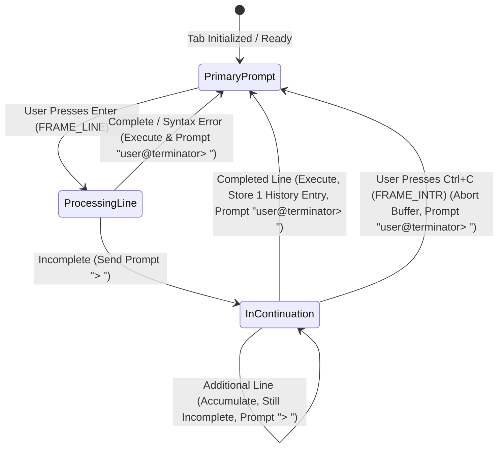
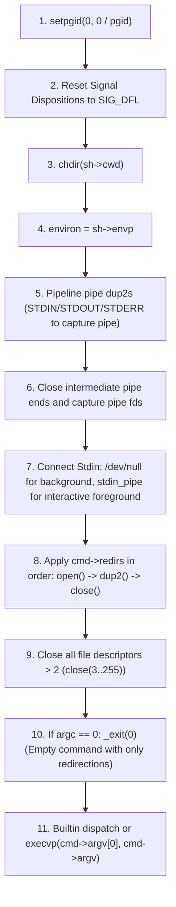
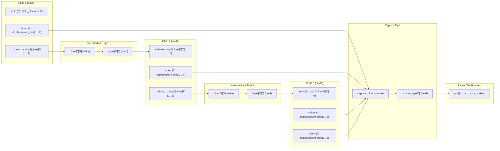
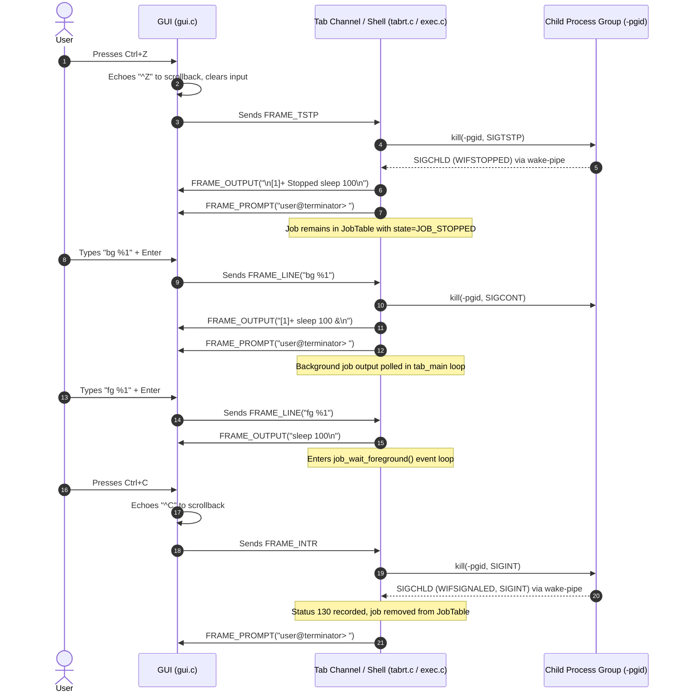

# Terminator Design Document

## 1. System Overview
Terminator is a high-performance Linux terminal emulator and shell written in C (gnu11) from first principles using Xlib (libX11), POSIX system calls, threads, semaphores, and anonymous shared memory.

Terminator operates in two interchangeable execution modes that behave identically:
- **Thread Mode (`./terminator`)**: GUI runs on the main thread; each tab runs its shell backend in a dedicated POSIX thread.
- **Process Mode (`./terminator useProcess=True`)**: GUI runs in the parent process; each tab runs in a separate forked child process.

---

## 2. GUI and Event Loop

### Xlib Integration & Window Management
- **Display & Window**: Connected via `XOpenDisplay` and created using `XCreateSimpleWindow`.
- **Event Mask**: Window listens for `KeyPress`, `KeyRelease`, `ButtonPress`, `ButtonRelease`, `PointerMotion`, `EnterWindow`, `LeaveWindow`, `Expose`, `StructureNotify` (`ConfigureNotify`), and `FocusChange` (`FocusIn`/`FocusOut`).
- **WM Protocols**: `WM_DELETE_WINDOW` is registered via `XSetWMProtocols` to allow clean window termination by window managers.
- **Size Hints & Class**: `XSetWMNormalHints` enforces a minimum window size of 400x240 and character-aligned resize increments. `XSetClassHint` provides WM identity `("terminator", "Terminator")`.

### Nonblocking Event Loop & Zero Busy-Waiting
- The event loop is driven entirely by a single blocking `poll()` call. There are no timers, busy-wait loops, or spinning threads.
- Monitored descriptors:
  1. `ConnectionNumber(dpy)`: X11 server connection fd (`POLLIN`).
  2. Each active tab's `from_tab_fd`: Tab output pipe (`POLLIN | POLLHUP`).
  3. Active tabs with pending data in `pending_out`: Tab input pipe (`POLLOUT`).
- **Synchronization Rules**:
  - `XPending(dpy)` is completely drained and all events handled before entering `poll()`.
  - `XFlush(dpy)` is called immediately prior to `poll()`.
  - Screen rendering is batched: a `dirty` flag tracks whether any X events or tab output arrived during the iteration, triggering at most one redraw per loop pass.

### Double-Buffered Rendering
- Redrawing directly into the visible window causes flickering during rapid output and scrolling.
- Terminator renders off-screen into an X11 `Pixmap` backbuffer created with matching window geometry.
- After all background elements, tabs, text lines, cursor, and scrollbars are drawn to the `Pixmap`, a single `XCopyArea` blits the backbuffer to the visible window.
- On `ConfigureNotify` window resize, the `Pixmap` is freed and reallocated to the new dimensions.

### Tab Strip Layout & Styling
- **Dimensions**: 32 px tab strip at the top of the window.
- **Geometry**: Tab widths are evenly distributed and clamped between 80 px and 200 px.
- **Appearance**: Tabs feature rounded top corners (6 px radius) drawn using `XFillArc` and `XFillRectangle`. Active tabs are drawn with elevated background highlight (`#3C3C3E` in dark mode, `#FFFFFF` in light mode), inactive tabs sit flush with the strip background (`#2B2B2D` / `#E8E8E8`). A 1 px separator line (`#3A3A3C` / `#D1D1D6`) borders the strip bottom.
- **Controls**:
  - Close Button (`x`): Appears on active tabs and when hovering over inactive tabs. Clicking `x` closes the tab.
  - New Tab Button (`+`): Positioned immediately following the last tab. Clicking `+` spawns a new tab.
  - Switching: Tabs can be switched by mouse click, `Alt+1..9`, or `Ctrl+PageUp`/`Ctrl+PageDown`.
  - Shortcuts: `Ctrl+Shift+T` spawns a tab, `Ctrl+Shift+W` closes the current tab.

### Text Buffer, Formatting, and Reflow
- `TabBuf` maintains a ring buffer of up to 10,000 logical lines per tab.
- **Output Processing**:
  - `\n`: Completes the current logical line and advances to the next buffer line.
  - `\r`: Resets the write column to 0 without clearing or creating a line, allowing overwriting.
  - `\t`: Advances write column to the next 8-column tab stop (`(col + 8) & ~7`), padding with spaces.
  - `\b`: Decrements the write column (`col > 0 ? col - 1 : 0`).
  - ANSI Escape Sequences: A state machine strips ESC, CSI (e.g. `\033[...m`), and OSC sequences.
- **Reflow at Render Time**: Logical lines are wrapped dynamically based on the current window column count `(width - 20) / font_width`. Resizing the window immediately reflows text without data loss.
- **Scrolling**:
  - Mouse wheel (`Button4`/`Button5`) scrolls up/down 3 lines per notch.
  - `Shift+PageUp`/`Shift+PageDown` scrolls by one full visible page.
  - Typing or receiving new output automatically resets `scroll_offset = 0` to follow bottom output.
  - A slim 4 px scrollbar thumb is drawn at the right margin when scrolled up.

---

## 3. Thread vs Process Mode and Shared State

### Architecture Comparison
| Attribute | Thread Mode (`./terminator`) | Process Mode (`./terminator useProcess=True`) |
|---|---|---|
| Tab Concurrency | One pthread per tab (`pthread_create`) | One forked process per tab (`fork()`) |
| IPC Mechanism | Two unidirectional pipes (`to_tab`, `from_tab`) | Two unidirectional pipes (`to_tab`, `from_tab`) |
| Tab Termination | Send `FRAME_CLOSE`, join pthread (`pthread_join`) | Send `FRAME_CLOSE`, wait on child (`waitpid(pid)`) |
| Crash Isolation | Crash inside thread affects parent | Crashed tab reaped with `WNOHANG`; GUI & other tabs unaffected |
| X11 Isolation | GUI thread only touches X11 | Child closes X connection fd `close(ConnectionNumber(dpy))` |

### Cross-Cutting Process Hazards
1. **Directory and Environment Mutation**: In POSIX, `chdir()`, `setenv()`, and file descriptor redirection (`dup2`) onto standard descriptors (0, 1, 2) are process-wide. To prevent threads from interfering with one another in thread mode:
   - Tab shell states maintain an independent per-tab `cwd` string and environment structures.
   - `chdir(tab->cwd)` is strictly executed *inside the forked command process* between `fork()` and `execvp()`.
   - Redirection of stdout/stderr into capture pipes is executed strictly in the child process.
2. **Signal Handling**:
   - The GUI process sets signal dispositions to `SIG_IGN` for `SIGINT`, `SIGQUIT`, `SIGTSTP`, `SIGTTIN`, `SIGTTOU`, and `SIGPIPE`.
   - Child processes spawned for external commands reset all signal handlers to `SIG_DFL` before calling `execvp()`.
   - Child processes run in their own process group via `setpgid(0, 0)` in the child and `setpgid(pid, pid)` in the tab parent to prevent race conditions.
3. **Child Waiting**:
   - `waitpid(-1, ...)` or `wait()` is never called in the shell core, as it could steal child exit statuses belonging to other concurrent tabs.
   - Explicit PIDs are always passed to `waitpid(tab->pid, ...)`.

### Shared Memory & Dead-Owner Recovery
- Shared state is mapped prior to tab creation via `mmap(NULL, sizeof(Shared), PROT_READ | PROT_WRITE, MAP_SHARED | MAP_ANONYMOUS, -1, 0)`.
- It contains:
  - Process-shared semaphore (`sem_init(&shared->sem, 1, 1)` on Linux).
  - Ring buffer of 10,000 history entries with monotonic sequence numbers.
- **Dead-Owner Detection**:
  - `shared->owner_pid` records the PID holding the shared memory lock.
  - When acquiring the lock, `sem_timedwait` uses a 2-second timeout.
  - On timeout, if `owner_pid > 0` and `kill(owner_pid, 0) == -1 && errno == ESRCH`, the process that held the lock has crashed.
  - Waiters detect the dead owner and safely re-initialize the semaphore, claiming ownership without deadlocking the entire terminal.

---

## 4. Frame Protocol

Tabs communicate with the GUI exclusively across two unidirectional pipes carrying framed binary messages.

### Frame Layout
```
+---------------+------------------------+------------------------------------+
| Type (1 byte) | Length (4 bytes, LE)   | Payload (0 to 65,536 bytes)        |
+---------------+------------------------+------------------------------------+
```

### Message Types
| Direction | Type | Code | Description |
|---|---|---|---|
| GUI -> Tab | `FRAME_LINE` | `0x01` | User submitted command line |
| GUI -> Tab | `FRAME_INTR` | `0x02` | SIGINT interrupt request (Ctrl+C) |
| GUI -> Tab | `FRAME_TSTP` | `0x03` | SIGTSTP suspend request (Ctrl+Z) |
| GUI -> Tab | `FRAME_EOF` | `0x04` | EOF indicator (Ctrl+D on empty line) |
| GUI -> Tab | `FRAME_CLOSE` | `0x05` | Close tab request |
| GUI -> Tab | `FRAME_RESIZE` | `0x06` | Terminal dimensions update (`cols`, `rows`) |
| Tab -> GUI | `FRAME_OUTPUT` | `0x10` | Output byte stream (stdout / stderr) |
| Tab -> GUI | `FRAME_PROMPT` | `0x11` | CWD and prompt update (`<cwd>\0<prompt>`) |
| Tab -> GUI | `FRAME_RELOAD_KEYS` | `0x12` | Request to reload hotkey configuration |
| Tab -> GUI | `FRAME_EXIT` | `0x13` | Tab shell exited (`status`) |
| Tab -> GUI | `FRAME_CLEAR` | `0x14` | Request active tab buffer clear |

### Nonblocking Buffering
- In the GUI, writing directly to tab pipes in a blocking fashion could stall the entire GUI event loop if a tab buffer fills up.
- Each tab maintains an `OutQueue` buffer. Outgoing frames are enqueued and drained nonblockingly on `POLLOUT`.
- `InBuffer` buffers incoming bytes and disassembles partial frames across reads.

---

## 5. Process and Execution Management (Task 2)

### Explicit Child PID Tracking
- In thread mode, `waitpid(-1, ...)` or `wait()` is hazardous because multiple tab threads share the same process: one thread's `waitpid(-1)` could intercept and reap a child belonging to another tab.
- Terminator exclusively tracks explicit child PIDs (`waitpid(explicit_pid, ...)`).
- When an external command is executed, `pid_t pid = fork()` is invoked. Both parent and child immediately call `setpgid(pid, pid)` to place the child into its own distinct process group and avoid process group race conditions.

### Async-Signal-Safe Child Notification
- A global `SIGCHLD` handler is installed with `SA_RESTART | SA_NOCLDSTOP`.
- When any child terminates or changes state, the handler iterates through a thread-safe registry of per-tab wake pipes (`g_wake_fds[]`) and performs an async-signal-safe single-byte `write(fd, "C", 1)`.
- The per-tab event loop in `shell_execute_cmd` poll()s `{to_tab_fd, capture_pipe[0], sh->wake_pipe[0]}`.
- Upon receiving a wake byte, the tab drains the wake pipe and invokes `waitpid(pid, &status, WNOHANG | WUNTRACED | WCONTINUED)`.

### Grandchild Pipe Leak Prevention
- External commands have their `stdout` and `stderr` redirected via `dup2` to the write end of a pipe (`capture_pipe`).
- The read end of the capture pipe is configured with `O_NONBLOCK`.
- If an external command spawns a background grandchild process that inherits the capture pipe write end, a naive blocking read would hang indefinitely even after the child command exits.
- In Terminator, the tab loop only monitors the capture pipe until the explicit child process is reaped by `waitpid`. Once the child is reaped, a final nonblocking drain of `capture_pipe[0]` reads all remaining bytes until `EAGAIN` or `EOF`, and then immediately closes the pipe. This guarantees grandchildren holding open descriptors can never hang foreground execution.

### Signal Reset and Exit Statuses
- Prior to calling `execvp`, the child resets all signals (`SIGINT`, `SIGQUIT`, `SIGTSTP`, `SIGTTIN`, `SIGTTOU`, `SIGPIPE`, `SIGCHLD`) to `SIG_DFL`.
- Exit statuses follow standard POSIX conventions:
  - Normal exit: `WEXITSTATUS(status)`
  - Signal termination: `128 + WTERMSIG(status)`
  - Executable not found (`ENOENT`): Exit code 127, printing `"terminator: <cmd>: command not found\n"`
  - Permission denied or directory (`EACCES`, `EISDIR`): Exit code 126, printing `"terminator: <cmd>: Permission denied\n"`
- Status is recorded in `sh->last_status` and synced to the special variable `$?`.

---

## 6. Built-ins, Output Sinks, and Per-Tab State Isolation (Task 2)

### Per-Tab Shell State
Each tab possesses an isolated `Shell` struct containing:
- `cwd`: The logical current working directory string (up to 1024 characters).
- `vars`: A linked-list symbol table (`VarTable`) storing local and exported variables, plus the special `$?` status variable.
- `envp`: A dynamically maintained `char **` environment array built from exported variables, passed directly to `environ` in child processes.
- `wake_pipe`: Pipe pair for `SIGCHLD` notifications.
- `shared`: Pointer to the anonymous mmap shared region containing the history ring and process-shared semaphore.
- **Zero Global State**: No shell state is stored in global or static variables, ensuring complete isolation across threads.

### Output Sink Abstraction (`OutputSink`)
- Built-ins can run directly in the parent tab thread or inside forked subshells/pipelines.
- To avoid calling `dup2` onto standard file descriptors (0, 1, 2) in thread mode, built-ins write to an `OutputSink`:
  - `SINK_FRAMED`: For interactive built-ins in the foreground tab. Buffers output in chunks up to 32 KiB and sends them as `FRAME_OUTPUT` binary frames to the GUI.
  - `SINK_RAW_FD`: For built-ins participating in pipelines, redirection, or forked subshells, writing directly to the target file descriptor without touching GUI pipes.
- This abstraction completely prevents deadlocks where a built-in writing >64 KiB would fill a GUI frame queue.

### Built-in Commands Implementation
- **`cd`**:
  - Without arguments: Resolves to `$HOME` (falling back to `/`).
  - Argument `-`: Resolves to `$OLDPWD` and outputs the target directory.
  - Tilde expansion: `~` or `~/...` is expanded to the user's home directory.
  - Validation: Verifies destination existence with `stat(path, &st)` and directory check `S_ISDIR(st.st_mode)`, and checks traversal permissions with `access(path, X_OK)`.
  - Process Isolation: **NEVER calls `chdir()` in the process/tab context**. Path normalization is performed by canonical string resolution and `realpath`. Updates `sh->cwd`, `$PWD`, and `$OLDPWD`.
- **`pwd`**: Writes `sh->cwd` directly to the output sink.
- **`echo`**:
  - Supports `-n` (suppress trailing newline), `-e` (interpret backslash escapes: `\a`, `\b`, `\e`, `\f`, `\n`, `\r`, `\t`, `\v`, `\\`, and `\c` to halt output), and `-E` (disable backslash escapes).
- **`history`**:
  - Displays the last 1000 executed commands from the shared history ring buffer.
  - Formats output identical to bash: `%5d  %s\n` using the entry's monotonic sequence number.
- **`export` & `unset`**:
  - `export VAR=VALUE` or `export VAR` exports shell variables into `sh->envp`.
  - `unset VAR` removes the variable and rebuilds `sh->envp`.
- **`exit`**:
  - Sets `sh->should_exit = true` and `sh->exit_code`.
  - Signals the tab loop in `tab_main` to terminate cleanly and close the tab.
- **`clear`**:
  - Clears the active tab terminal screen and resets the scrollback viewport to the prompt (identical to `Ctrl+L`).
  - When executed in the foreground tab shell (`SINK_FRAMED`), sends a binary `FRAME_CLEAR` (opcode `0x14`) IPC frame to the GUI, calling `tabbuf_clear()` and `tabbuf_scroll_to_bottom()`.
  - When executed in a pipeline or redirected (`SINK_RAW_FD`), writes the standard ANSI clear sequence (`\033[H\033[2J`).
  - The GUI's `TabBuf` ANSI escape parser natively interprets CSI Erase in Display sequences (`\033[2J` and `\033[3J`), providing dual-layer clear screen support.
- **Stubs**:
  - `multiWatch`, `jobs`, `fg`, `bg`, `source` print `"terminator: <name>: not implemented yet\n"` and return status 1.

### Cross-Tab Shared History
- Every non-empty command line is appended to the shared history ring buffer before execution using `history_append(sh->shared->history, line)`.
- Critical sections are protected by `shared_lock` with dead-owner timeout recovery.
- Commands executed in any tab immediately become visible in the `history` output of all other tabs.

---

## 7. Lexing, Quoting, and Expansion (Task 3)

### Hand-Written Single-Pass Lexer & Token Model
Terminator does not use `lex`, `yacc`, or regex libraries. Parsing is performed by a hand-written single-pass state machine in `src/shell/lexer.c`.

#### Token Kinds
- `TOK_WORD`: One or more word segments.
- `TOK_PIPE` (`|`), `TOK_AMP` (`&`), `TOK_SEMI` (`;`), `TOK_NEWLINE` (`\n`).
- `TOK_LESS` (`<`), `TOK_GREAT` (`>`), `TOK_DGREAT` (`>>`).
- `TOK_AND` (`&&`), `TOK_OR` (`||`).
- `TOK_EOF`: End of token stream.

#### Word Segments and Quoting Kinds
A single shell word (such as `foo"$BAR"'baz'`) is represented as a linked list of `WordSegment` nodes, each retaining its quote context:
- `QUOTE_NONE`: Unquoted text. Subject to tilde expansion, parameter expansion, command substitution, word splitting on whitespace, and pathname globbing.
- `QUOTE_SINGLE`: Literal text inside `'...'`. Preserves every character verbatim without expansion, splitting, or globbing.
- `QUOTE_DOUBLE`: Text inside `"..."`. Literal for spaces and metacharacters; expands `$VAR`, `${VAR}`, `$?`, `$$`, `$#`, `$0..$9`, `$(...)`, and `` `...` ``. Never undergoes word splitting or pathname globbing. Backslash inside double quotes only escapes `$`, `` ` ``, `"`, `\`, and newline.

### Multiline Continuation & State Machine
When a user submits a line, Terminator inspects it with `lex_check_completeness()`. If the input is incomplete (due to an unclosed quote, unclosed subshell/backtick, trailing backslash, or trailing pipe), Terminator enters continuation mode:
1. It responds to the GUI with a continuation prompt `FRAME_PROMPT` containing `"> "`.
2. It accumulates subsequent `FRAME_LINE` inputs, joining them with `\n` (splicing out trailing backslash-newline outside quotes).
3. `FRAME_INTR` (Ctrl+C) while in continuation immediately aborts the pending buffer, resets to the primary prompt `"user@terminator> "`, and discards the incomplete command.
4. Once completed, the entire multiline command string is committed to shared history as **ONE** single entry.



### 6-Stage Word Expansion Pipeline (`src/shell/expand.c`)
Every `TOK_WORD` token passes through 6 sequential expansion stages:
1. **Tilde Expansion**:
   - `~` expands to the tab's `$HOME` (or `getpwuid` fallback).
   - `~/path` expands to `$HOME/path`.
   - `~username` expands to `getpwnam(username)->pw_dir`.
   - Only performed on `QUOTE_NONE` segments at the very start of a word. Quoted tildes (`'~'` or `"~"`) remain literal.
2. **Parameter Expansion**:
   - `$VAR` and `${VAR}` expanded from per-tab `VarTable` (falling back to process environment).
   - `$?`: Last foreground exit status.
   - `$$`: Main Terminator process PID.
   - `$#`: Number of positional arguments (defaults to `0`).
   - `$0`: Process name (`"terminator"`).
   - `$1`..`$9`: Positional arguments.
   - Undefined variables expand to an empty string.
3. **Command Substitution**:
   - Recursively supports `$( ... )` and `` `...` `` up to a maximum recursion depth of 16 (`MAX_SUBST_DEPTH`).
   - Backticks nest cleanly via `\` escapes (e.g. `\`echo inner\``).
   - Evaluated innermost-first: each substitution spawns an isolated subshell child process (`fork()`) with `stdout` redirected to a capture pipe. The child executes the inner pipeline using raw file descriptors and never acquires shared history locks. The parent reads to EOF, reaps the child with `waitpid`, and strips trailing newlines.
4. **Word Splitting**:
   - Only applied to unquoted (`QUOTE_NONE`) expanded characters.
   - Splits on standard shell whitespace (`' '`, `'\t'`, `'\n'`).
   - Quoted text (`QUOTE_SINGLE` or `QUOTE_DOUBLE`) is never split.
   - Empty quoted arguments (e.g. `""` or `''`) are preserved as distinct arguments, while unquoted empty expansions are discarded.
5. **Pathname Globbing**:
   - Patterns containing `*`, `?`, or `[...]` in unquoted segments are expanded via libc `glob(3)`.
   - **Zero `chdir()` Hazard**: Because `chdir()` is process-wide in thread mode, `glob()` is resolved with paths relative to the tab's current `sh->cwd` without modifying the global working directory.
   - If no files match the pattern, the pattern remains intact as a literal word.
6. **Quote Removal**:
   - All quote characters enclosing segments are removed, assembling the final contiguous argument strings.

### Specification Deviation: `DQUOTE_BACKSLASH_NEWLINE_KEEPS_NEWLINE`
- **Standard POSIX / Bash Rule**: In standard bash, a backslash followed by a newline inside double quotes is treated as a line continuation and removed entirely (`\<newline>` is erased).
- **Terminator Spec Rule**: Requirement 3 specifies:
  ```
  echo "Isn't process creation exciting?\
  > Fork, exec, repeat!"
  ```
  must output two distinct lines:
  ```
  Isn't process creation exciting?
  Fork, exec, repeat!
  ```
- **Implementation**: Terminator gates this behavior behind the configuration macro `DQUOTE_BACKSLASH_NEWLINE_KEEPS_NEWLINE 1` in `src/shell/lexer.h`. When enabled, inside double quotes a `\` immediately followed by `\n` drops the backslash and preserves the newline character into the string segment, exactly matching the specification example.

---

## 8. IPC: Pipes, dup2, and Redirection (Task 4)

### Core Architectural Principles
Terminator implements UNIX I/O redirection from first principles using standard POSIX primitives: `open()`, `dup()`, `dup2()`, `pipe2()`, `close()`, `poll()`, and `fork()`. Redirection is fully integrated with pipelines, multiline quoting, parameter expansion, and built-in execution.

Supported redirection operators:
- `< file`: Redirect standard input (`STDIN_FILENO`) from `file` (`O_RDONLY`).
- `> file`: Redirect standard output (`STDOUT_FILENO`) to `file` (`O_WRONLY | O_CREAT | O_TRUNC`, mode 0666).
- `>> file`: Append standard output to `file` (`O_WRONLY | O_CREAT | O_APPEND`, mode 0666).
- `2> file`: Redirect standard error (`STDERR_FILENO`) to `file`.
- `2>&1`: Duplicate standard error to whatever standard output currently points to (`dup2(1, 2)`).
- Multiple simultaneous redirections: e.g. `./a.out < infile.txt > outfile.txt`, `sort < in > out 2> err`.

### Independent Open File Descriptions (Concurrency Guarantee)
A critical requirement is that concurrent commands reading the same file (e.g. concurrent background jobs or subshells) must possess completely independent file offsets.
- **Why Parent-Open is Forbidden**: If the parent process were to call `open()` and share that descriptor across forked children, the children would share the same underlying kernel file description (`struct file`) and a single shared file offset. Readers would interleave and consume alternate chunks of data.
- **The First-Principles Solution**: Redirection target files are opened **strictly inside the forked child process** after `fork()`. Every child calls `open()` independently, receiving a private kernel open file description with an isolated offset starting at 0. Concurrent readers of the same file never interfere.

### Child Process Setup Order
To prevent race conditions, descriptor leaks, and pipeline interference, the child executes a strict, deterministic setup sequence between `fork()` and `execvp()`:



Because Step 8 (redirection `dup2`s) occurs after Step 5 (pipeline `dup2`s), redirections correctly override pipeline ends (e.g. `cat file | sort > out` writes `sort`'s output to `out` rather than the pipeline capture).

### In-Process Built-in Redirection in Tab Context
In Thread Mode, calling `dup2()` over standard file descriptors 0, 1, or 2 inside a tab thread is strictly forbidden by `AGENTS.md` because file descriptors 0/1/2 are process-wide.
- When a single built-in (such as `pwd > p.txt`, `history > h.txt`, or `echo hi >> file`) is executed:
  1. The target file is opened in the tab context relative to `sh->cwd` with `O_CLOEXEC`.
  2. If opening fails (e.g. permission denied or invalid directory), an error frame is sent directly to `from_tab_fd`, and the command returns exit status 1 without modifying any global state.
  3. If opening succeeds, the resulting file descriptor is wrapped in `OutputSink out = sink_raw(out_fd)`.
  4. The built-in executes and writes directly to `out_fd`.
  5. The file descriptor is closed cleanly.
  6. Neither standard descriptors 0/1/2 nor process-wide tables are modified.

### Interactive Foreground Stdin Plumbing
For foreground commands that have no `<` input redirection (such as interactive `cat`):
1. The shell creates a dedicated nonblocking `stdin_pipe[2]`.
2. The child duplicates `stdin_pipe[0]` onto `STDIN_FILENO` and closes both ends of `stdin_pipe`.
3. The parent tab loop retains `stdin_pipe[1]`. While polling:
   - When the GUI user submits input lines, the tab receives `FRAME_LINE` frames and forwards them with `\n` to `stdin_pipe[1]`.
   - When the user presses `Ctrl+D`, the GUI sends a `FRAME_EOF` frame. The tab closes `stdin_pipe[1]`, causing the foreground command to receive `EOF` on standard input and terminate naturally.
   - When the user presses `Ctrl+C`, the GUI sends `FRAME_INTR`. The tab delivers `SIGINT` to the child process group (`kill(-pgid, SIGINT)`) and closes `stdin_pipe[1]`.

### Syntax Errors and Ambiguous Redirection
- **Syntax Errors ($? = 2)**:
  Malformed redirection syntax (such as trailing redirection operators `sort <`, doubled operators `> >`, or redirection followed by a pipe `< |`) are detected during parsing. The shell prints `terminator: syntax error near unexpected token '...'` to the tab, records exit status 2, and runs nothing.
- **Ambiguous Redirection ($? = 1)**:
  The target filename word undergoes normal shell expansions (tilde, parameter, command substitution). If the expansion results in anything other than exactly one word (such as an unset or empty variable `cat < $EMPTY`, or a multi-word expansion `cat < $MULTI`), the shell aborts with `terminator: ambiguous redirect`, records exit status 1, and runs nothing.
- **Zero FD Leaks**:
  All descriptors greater than 2 are closed prior to `execvp()`. File descriptor count remains perfectly constant across 1,000+ executed commands.

---

## 9. Pipelines of Any Length (Task 5)

### Architectural Model
Terminator supports arbitrary-length UNIX pipelines ($N$ commands connected by $N-1$ intermediate pipes, e.g. `cat abc.c | sort | head -5`, `seq 1 200000 | sort -n | tail -1`, `ls *.txt | xargs rm`).
Pipelines are executed from first principles without shell invocation wrappers:
1. **Dynamic Allocation**: The parser dynamically allocates `cmds` for arbitrary $N$. The executor allocates $N-1$ pipe descriptors `pipes[N-1][2]`, $N$ process IDs `pids[N]`, and completion tracking `child_done[N]`.
2. **Up-Front Pipe Creation**: All $N-1$ pipes are created up front using `pipe2(pipes[j], O_CLOEXEC)`. If pipe creation partway encounters `EMFILE` or `ENFILE`, all previously allocated pipes and capture pipes are immediately closed, freeing memory and reporting a clean error without descriptor leaks.
3. **Shared Process Group**: The first child establishes the pipeline's process group with `setpgid(0, 0)` (and `pgid = pids[0]`). Every subsequent child joins the process group with `setpgid(0, pgid)`. To eliminate kernel race conditions where a child might run before the parent sets its process group (or vice versa), `setpgid()` is invoked in **both** the parent tab and each child.
4. **Immediate Parent Pipe Closure**: Immediately after the $N$-th child is forked, the parent tab process closes all $N-1$ intermediate pipe read and write ends (`close(pipes[j][0])` and `close(pipes[j][1])`) as well as the capture pipe write end (`capture_pipe[1]`).

### Descriptor Flow & Closing Diagram (N = 3 Pipeline)
For an $N = 3$ pipeline (e.g. `cmd1 | cmd2 | cmd3`):
Two intermediate pipes (`pipes[0]`, `pipes[1]`) and one capture pipe (`capture_pipe`) are created.



#### Closing Order & Descriptors Lifecycle:
1. **In Parent immediately after forking all $N$ children**:
   - `close(pipes[0][0])` and `close(pipes[0][1])`
   - `close(pipes[1][0])` and `close(pipes[1][1])`
   - `close(capture_pipe[1])`
   - `close(stdin_pipe[0])` (if interactive stdin pipe was created)
2. **In Child 1**:
   - `dup2(pipes[0][1], STDOUT_FILENO)`
   - `dup2(capture_pipe[1], STDERR_FILENO)`
   - Closes `pipes[0][0]`, `pipes[0][1]`, `pipes[1][0]`, `pipes[1][1]`, `capture_pipe[0]`, `capture_pipe[1]`
   - Closes all fds $3 \dots \text{max\_fd}$
3. **In Child 2**:
   - `dup2(pipes[0][0], STDIN_FILENO)`
   - `dup2(pipes[1][1], STDOUT_FILENO)`
   - `dup2(capture_pipe[1], STDERR_FILENO)`
   - Closes all pipe fds, then closes all fds $3 \dots \text{max\_fd}$
4. **In Child 3**:
   - `dup2(pipes[1][0], STDIN_FILENO)`
   - `dup2(capture_pipe[1], STDOUT_FILENO)` (unless overridden by `> outfile`)
   - `dup2(capture_pipe[1], STDERR_FILENO)`
   - Closes all pipe fds, then closes all fds $3 \dots \text{max\_fd}$

### Correct EOF and SIGPIPE Propagation
- **Why Parent Closure is Critical**: If the parent process failed to close any pipe write end (e.g. `pipes[0][1]`), Child 2 would never receive `EOF` when Child 1 finished, because the write end would remain open in the parent. Similarly, if Child 2 exited early (e.g. `head -1` in `yes | head -1`), Child 1 would never receive `SIGPIPE` on write because the read end would remain open in the parent.
- **Immediate SIGPIPE**: All children explicitly restore `SIGPIPE` disposition to `SIG_DFL` before executing (`sigaction(SIGPIPE, &sa, NULL)`). When a downstream consumer terminates, the upstream producer receives `SIGPIPE` upon its next `write()` and exits immediately, preventing hangs and endless loops.

### Built-in Commands in Pipelines
- When a built-in command (such as `echo`, `pwd`, `history`, `cd`, or `export`) appears in a multi-stage pipeline:
  - It runs **inside a forked child process**, exactly matching standard bash behavior.
  - The child configures standard input, standard output, and standard error as raw file descriptors connected to the pipeline or capture pipes (`sink_raw(STDOUT_FILENO)`).
  - State mutations (such as changing directory via `cd /tmp` or setting variables via `export FOO=bar`) execute in the child's address space. The parent tab's `cwd` and variable environment remain unaffected.
  - The child calls `_exit(status)` without calling `exit()`, ensuring process-shared locks and semaphores are never touched.

### Exit Status and Event-Driven Polling
- **Pipeline Status ($?$)**: Consistent with standard POSIX shell semantics, the exit status of the pipeline is the exit status of the **last command** ($N-1$). If an intermediate command fails (e.g. `echo hello | false | cat`), `$?` is 0.
- **Poll Loop**: The parent tab executes an event-driven `poll()` loop over:
  - `to_tab_fd`: User keystrokes, Ctrl+C (`FRAME_INTR`), Ctrl+D (`FRAME_EOF`), or tab closure (`FRAME_CLOSE`).
  - `capture_pipe[0]`: Stream of stdout from the last stage and stderr from all stages, forwarded nonblockingly as `FRAME_OUTPUT` frames.
  - `wake_pipe[0]`: Triggered asynchronously by `SIGCHLD` notifications.
- **Child Reaping**: The loop never calls blocking `waitpid(-1, ...)` or `wait()`. Instead, it invokes `waitpid(pids[k], &st, WNOHANG | WUNTRACED | WCONTINUED)` strictly on explicit pipeline PIDs until all children are reaped.
- **Fork Failure Recovery**: If `fork()` fails at child $i$, the parent signals `SIGTERM` to `kill(-pgid, SIGTERM)` on already-forked children, waits for them, closes all open pipes, drains the capture pipe, and returns cleanly with status 1, guaranteeing zero orphaned zombie processes.

---

## 10. multiWatch Concurrent Execution Engine

### Architectural Overview
The `multiWatch` subsystem implements parallel periodic execution of multiple commands without blocking the shell or busy-waiting. Given a command of the form:
```sh
multiWatch [-n <seconds>] ["cmd1", "cmd2", ...]
```
Terminator launches all $N$ commands concurrently in separate processes, captures and buffers each process's output streams, emits completed runs as atomic, un-interleaved blocks, and reschedules each command at monotonic time intervals until interrupted by `Ctrl+C` (`FRAME_INTR`) or tab closure (`FRAME_CLOSE`).

```mermaid
flowchart TD
    subgraph TabLoop ["Parent Tab (multiwatch_run)"]
        direction TB
        MPoll["Single poll({to_tab, wake_pipe, pipe_r[0]...pipe_r[N-1]}, timeout=min_deadline)"]
        MReap["waitpid(pid) on EOF -> print atomic block -> schedule next run"]
        MPoll -->|EOF on pipe_r[i]| MReap
    end

    subgraph Child0 ["Child 0 (pgid 0)"]
        direction TB
        C0["shell_execute_subshell('cmd1')"]
        C0Out["stdout + stderr -> dup2(pipe_w[0], 1 & 2)"]
    end

    subgraph Child1 ["Child 1 (pgid 1)"]
        direction TB
        C1["shell_execute_subshell('cmd2')"]
        C1Out["stdout + stderr -> dup2(pipe_w[1], 1 & 2)"]
    end

    subgraph Pipe0 ["Pipe 0"]
        direction TB
        P0_W["pipe_w[0]"] --> P0_R["pipe_r[0]"]
    end

    subgraph Pipe1 ["Pipe 1"]
        direction TB
        P1_W["pipe_w[1]"] --> P1_R["pipe_r[1]"]
    end

    C0Out --> P0_W
    C1Out --> P1_W
    P0_R --> MPoll
    P1_R --> MPoll
```

### 1. Dedicated Syntax Parser
Because bracketed argument lists `["cmd1", "cmd2", ...]` diverge from standard POSIX shell grammar, `multiWatch` is intercepted at the top of command dispatch in `shell_execute_line` and `shell_execute_subshell` before reaching the POSIX lexer.
- **Interval Specification**: Supports an optional `-n <seconds>` flag (floating-point or integer, e.g. `-n 0.5`, default 2.0 s).
- **Bracket Parsing**: Enforces leading `[` and trailing `]`, comma-separated list of quoted strings (`"..."` or `'...'`), backslash quote escapes (`\"` or `\'`), and verifies that no trailing non-whitespace characters follow `]`. Trailing commas before `]` (e.g. `["cmd",]`) are disallowed.
- **Error Handling**: Any malformed syntax immediately outputs:
  ```
  usage: multiWatch ["cmd1", "cmd2", ...]
  ```
  and returns status code 1 (`$? = 1`).

### 2. Process Group & Subshell Execution
For each monitored command:
1. A dedicated communication channel is created with `pipe2(pfd, O_CLOEXEC)`.
2. A child process is spawned via `fork()`.
3. In the child:
   - Calls `setpgid(0, 0)` so the child becomes the process group leader of its own process group. This guarantees signal isolation: signals sent to this process group do not reach the shell or other tabs.
   - Signals (`SIGINT`, `SIGQUIT`, `SIGTSTP`, `SIGTTIN`, `SIGTTOU`, `SIGPIPE`, `SIGCHLD`) are restored to `SIG_DFL`.
   - `chdir(sh->cwd)` applies the tab's current working directory.
   - `environ = sh->envp` configures the tab's isolated environment.
   - `dup2(pfd[1], STDOUT_FILENO)` and `dup2(pfd[1], STDERR_FILENO)` redirect stdout and stderr to the pipe.
   - All other pipes and file descriptors $> 2$ (up to `getdtablesize()`) are closed.
   - The command string is passed to `shell_execute_subshell()`, enabling full shell capabilities within each command (including pipelines and redirections, e.g. `"echo foo | tr a-z A-Z"`).
   - Upon completion, calls `_exit(status)`. In-process locks and X11 display connections are never accessed.

### 3. Non-Blocking Single Poll Loop & Monotonic Scheduling
To strictly adhere to the hard rule of **ZERO busy-waiting and ZERO `sleep()`**:
- The parent tab maintains a single `poll()` set containing:
  1. `to_tab_fd`: GUI control pipe monitoring `FRAME_INTR`, `FRAME_CLOSE`, and `FRAME_LINE`.
  2. `sh->wake_pipe[0]`: `SIGCHLD` wake notifications.
  3. `pipe_read_fd` of all currently active children.
- The `poll()` timeout is computed dynamically from `CLOCK_MONOTONIC`:
  - For all commands currently in `MW_IDLE` state awaiting their next interval run, the earliest monotonic deadline $T_{\text{next}} = T_{\text{start}} + \text{interval}$ is evaluated:
    $$\Delta T = \min_{i} (T_{\text{next}, i} - T_{\text{now}})$$
  - If $\Delta T \le 0$, the expired command is spawned immediately and $\text{timeout} = 0$.
  - If all commands are active, $\text{timeout} = -1$ (blocks indefinitely until file descriptor activity occurs).
  - If a command's execution time exceeds the watch interval, it is restarted immediately upon completion without waiting.

### 4. Atomic Block Assembly & Output Framing
Output from different concurrent commands must never interleave on screen:
- Each command buffers its captured output in a dynamically growing per-command buffer up to 1 MiB (`MULTIWATCH_MAX_OUTPUT`).
- If a command produces more than 1 MiB of output, subsequent output is truncated and `[output truncated]\n` is appended.
- When `read()` encounters `EOF` (signaling child termination), the parent:
  1. Reaps the child with `waitpid(cmd->pid, &st, 0)`.
  2. Assembles the complete output block formatted exactly according to specification:
     ```
     "<cmd>", <unix_timestamp>:
     ----------------------------------------------------
     <output>
     ----------------------------------------------------
     ```
     The 52-character dash line `MULTIWATCH_DASH_LINE` (`----------------------------------------------------\n`) is strictly enforced.
  3. If the command output does not end with a newline, an explicit newline is inserted before the closing dash line.
  4. If the assembled block exceeds the maximum protocol frame payload (`PROTO_MAX_PAYLOAD = 64 KiB`), it is split into chunks of at most 64 KiB and transmitted sequentially as `FRAME_OUTPUT` frames to the GUI.

### 5. Signal Isolation & Two-Stage Teardown
- **Ctrl+C (`FRAME_INTR`)**:
  - The parent immediately delivers `kill(-pgid, SIGTERM)` to every active child process group.
  - A 300 ms grace period is observed via `poll()` on `wake_pipe[0]`. Any surviving processes are forcefully killed with `kill(-pgid, SIGKILL)`.
  - All children are reaped via `waitpid()`.
  - Writes `"^C\n"` to the GUI and returns with status 130 (`$? = 130`).
  - No lingering zombie processes or orphaned children remain.
- **Tab Closure (`FRAME_CLOSE`)**:
  - All children are killed and reaped before setting `sh->should_exit = true`, ensuring clean process termination when tabs are closed.
- **Multi-Tab Concurrency**:
  - Because child processes run in distinct process groups (`setpgid(0, 0)`), pressing Ctrl+C in Tab 1 delivers signals strictly to Tab 1's child process group. Concurrent `multiWatch` instances in Tab 2 or background pipelines continue running unaffected.

---

## 11. Hotkeys, Input Line Editing, and X11 Selections

### 1. Architectural Separation & X-Free Modules
All input buffer manipulations and keymap configurations are strictly decoupled from X11 into portable, unit-testable C modules:
- `src/lineedit.c` / `src/lineedit.h`: Pure memory operations on input strings, cursor navigation, word boundary detection, and wrapped row/column layout calculations.
- `src/keymap.c` / `src/keymap.h`: Configuration parsing, chord normalization, chord comparison, hard-reserved chord validation, conflict detection, and atomic file serialization.
- `src/gui.c`: Connects X11 `KeyPress`, `ButtonPress`, `ButtonRelease`, and selection events to `lineedit` and `keymap`. Computes normalized modifiers, translates keysyms, and dispatches actions through an action table.

```
+--------------------+        +---------------------+        +--------------------+
|   X11 Event Loop   |        |   Keymap Engine     |        |   Line Editor      |
|  (KeyPress, etc.)  | -----> |   (Normalized Chord | -----> |   (Input Buffer,   |
|     src/gui.c      |        |     Resolution)     |        |   Cursor, Layout)  |
+--------------------+        |    src/keymap.c     |        |   src/lineedit.c   |
                              +---------------------+        +--------------------+
                                         ^
                                         | FRAME_RELOAD_KEYS
                              +---------------------+
                              |   Built-in 'bind'   |
                              |  (Shell / Tab Core) |
                              | src/shell/builtins.c|
                              +---------------------+
```

### 2. Line Editing Operations
Each tab maintains a dedicated `LineEdit` struct holding a bounded buffer (up to 4,096 bytes) and an integer cursor offset ($0 \le \text{cursor} \le \text{len}$).
- **Basic Operations**: `insert_char`, `insert_text`, `backspace`, `delete`, `line_start` (Home / Ctrl+A), `line_end` (End / Ctrl+E), `move_left`, `move_right`.
- **Bash-Style Deletion Primitives**:
  - `kill_to_start` (`Ctrl+U`): Erases all characters from the beginning of the line up to the cursor. Shifts remaining text to the buffer head and positions cursor at 0.
  - `kill_to_end` (`Ctrl+K`): Erases all characters from the cursor position to the end of the line.
  - `delete_prev_word` (`Ctrl+W`): Skips backwards past any trailing whitespace, then scans backwards to find the start of the non-whitespace word. Deletes the word span while preserving all text before and after.
- **Screen Clearing (`Ctrl+L`)**:
  - Clears the visible scrollback lines of the active tab (`tabbuf_clear`) and immediately redraws the prompt and current input line.
- **EOF Handling (`Ctrl+D`)**:
  - If input buffer is non-empty: Acts as `delete` (deletes character directly under cursor, bash behavior).
  - If input buffer is empty: Sends `FRAME_EOF` to the tab. If the shell is at the interactive prompt, the tab initiates a clean exit; if a foreground job is running, its stdin is closed.
- **Wrapped Row Layout Calculation (`lineedit_compute_layout`)**:
  - Computes visual row wrapping given terminal column width $W$:
    $$\text{cur\_row} = \frac{\text{prompt\_len} + \text{cursor}}{W}, \quad \text{cur\_col} = (\text{prompt\_len} + \text{cursor}) \pmod W$$
  - Total visual lines $\text{vlines} = \max\left(\left\lceil \frac{\text{prompt\_len} + \text{input\_len}}{W} \right\rceil, \text{cur\_row} + 1\right)$, ensuring the cursor row is always visible even when wrapped to column 0 of a new line.

### 3. Keymap Configuration & `~/.terminatorrc`
- **File Location**: Looked up via `$TERMINATORRC` environment variable; defaults to `~/.terminatorrc`.
- **Grammar**:
  ```
  # Comments start with hash
  bind <action> = <chord>
  bind <action> <chord>
  ```
- **Supported Actions**: `line_start`, `line_end`, `kill_to_start`, `kill_to_end`, `delete_prev_word`, `clear_screen`, `history_prev`, `history_next`, `copy`, `paste`, `eof`, `move_left`, `move_right`, `backspace`, `delete`, `return`.
- **Chord Specification**:
  - Case-insensitive modifiers: `Ctrl`, `Control`, `Shift`, `Alt`, `Mod1`, `Super`, `Mod4`, `Win`.
  - Keys: Standard letters (stored lowercase for keysym resolution, e.g. `c`, `a`), function keys, and navigation keys (`Up`, `Down`, `Left`, `Right`, `Home`, `End`, `Return`, `BackSpace`, `Delete`, `Page_Up`, `Page_Down`, `Tab`).
- **Reserved Chords**:
  - Terminator reserves system signal and tab management chords to prevent accidental lockouts:
    - `Ctrl+C` (SIGINT)
    - `Ctrl+Z` (SIGTSTP)
    - `Tab` (Tab Completion, Task 9)
    - `Ctrl+R` (Reverse History Search, Task 9)
    - `Ctrl+Shift+T` (New Tab)
    - `Ctrl+Shift+W` (Close Tab)
    - `Alt+1..9` (Switch Tab)
    - `Ctrl+Page_Up` / `Ctrl+Page_Down` (Previous/Next Tab)
    - `Shift+Page_Up` / `Shift+Page_Down` (Page Scroll)
  - Any attempt to bind a reserved chord is rejected with a warning:
    ```
    terminator: <file>:<line>: chord '<chord>' is reserved; using default for '<action>' (<default>)
    ```
- **Validation & Collision Resolution**:
  - Unknown action: Warning emitted, ignored.
  - Malformed chord: Warning emitted, fallback to default binding.
  - Duplicate chords: If two actions are bound to the same chord, the first action maintains the binding, and the second action emits a collision warning and falls back to its default chord.
- **Atomic File Saving (`keymap_save_file`)**:
  - Creates `<path>.tmp.XXXXXX` via `mkstemp()`, formats all current bindings, flushes, and atomically replaces the target file via `rename()`.
- **Built-in Command `bind`**:
  - `bind`: Lists all active key bindings in valid configuration format.
  - `bind <action> <chord>`: Validates action and chord, writes updated config atomically to disk, and sends a `FRAME_RELOAD_KEYS` frame to the GUI to re-read key mappings immediately without restarting.
  - `bind reset <action>`: Resets the specified action to its default chord.

### 4. History Browsing (Up / Down) Across Concurrent Tabs
- **Sequence-Number Based Browsing**:
  - Using array indices for history browsing creates race conditions when multiple tabs execute commands simultaneously.
  - History browsing in Terminator uses monotonic 64-bit sequence numbers (`history_newest_seq`, `history_get_by_seq`).
  - When the user presses `Up` from an interactive prompt:
    1. If not currently browsing history, the in-progress input line is saved to `tab->saved_input`.
    2. Monotonic sequence counter $S = \text{history\_newest\_seq}(\text{shared})$ is queried.
    3. The command text is retrieved via `history_get_by_seq` and replaces the input buffer.
  - Subsequent `Up` presses query $S - 1, S - 2, \dots$ down to the oldest available sequence.
  - Pressing `Down` navigates forward through newer sequence numbers.
  - Pressing `Down` past the newest sequence entry exits browsing mode and restores `tab->saved_input`.
- **Minimal Shared Lock Duration**:
  - Shared memory locks are held exclusively during the single-entry lookup and released immediately before updating GUI structures.

### 5. X11 Selections: Drag-to-Select, Copy & Paste
- **Primary Selection (Drag to Select & Middle Click)**:
  - Dragging the mouse across the terminal region tracks visual row and column offsets in scrollback and active input.
  - Highlighted cells are rendered in `gui_redraw` using the theme's selection background color.
  - Upon mouse release (`ButtonRelease`), the highlighted text is extracted into `gui->primary_selection_text` and Terminator acquires ownership of the X11 `XA_PRIMARY` selection via `XSetSelectionOwner`.
  - Middle-clicking (`Button2`) calls `XConvertSelection` for `XA_PRIMARY`.
- **Clipboard Selection (`Ctrl+Shift+C` / `Ctrl+Shift+V`)**:
  - `Ctrl+Shift+C` duplicates `primary_selection_text` into `clipboard_selection_text` and claims ownership of the `CLIPBOARD` atom.
  - `Ctrl+Shift+V` issues `XConvertSelection` for `CLIPBOARD` using target atom `UTF8_STRING` and property `TERMINATOR_SELECTION`.
- **Selection Request Protocol (`SelectionRequest`)**:
  - When an external X client requests selection contents, Terminator handles `SelectionRequest`:
    - `TARGETS`: Responds with supported atoms (`TARGETS`, `UTF8_STRING`, `XA_STRING`).
    - `UTF8_STRING` / `XA_STRING`: Stores the text in the requested window property with 8-bit format and sends `SelectionNotify`.
- **Event-Driven Paste & Sanitization (`SelectionNotify`)**:
  - Purely event-driven; no polling loops or blocking waits.
  - On `SelectionNotify`, data is read with `XGetWindowProperty` (capped at 64 KiB) and deleted from the window property.
  - **Pasting Sanitization**: Inner newlines (`\n`) are replaced with spaces (`' '`), carriage returns (`\r`) are discarded, and trailing newlines are stripped, matching standard safe terminal emulator paste semantics.

---

## 12. Signals and Job Control

### 1. Architectural Overview & Design Philosophy
Unlike traditional terminal emulators that rely on Linux tty/pty line disciplines to generate signals (`SIGINT` on `0x03`, `SIGTSTP` on `0x1A`), Terminator operates directly over pure pipes carrying framed protocol messages. Keystrokes are detected by the X11 GUI event loop and communicated to tabs as `FRAME_INTR` and `FRAME_TSTP` frames. The shell core itself maintains full process group hierarchy and manages signal dispatching via POSIX `kill(-pgid, sig)`.



### 2. Key Path & Frame Protocol
1. **Keystroke Detection**:
   - The GUI `handle_key_press` detects `Ctrl+C` (`norm_mods == KM_MOD_CTRL && (k == XK_c || k == XK_C)`) and `Ctrl+Z` (`norm_mods == KM_MOD_CTRL && (k == XK_z || k == XK_Z)`).
   - `action_intr`: Echoes `^C` (with prompt if idle, or alone if running), clears the input line, and sends a `FRAME_INTR` frame to the active tab only.
   - `action_tstp`: Echoes `^Z`, clears the input line, and sends a `FRAME_TSTP` frame to the active tab only.
2. **Tab Decision Dispatch**:
   - **Foreground Job Running**: `kill(-j->pgid, SIGINT)` or `kill(-j->pgid, SIGTSTP)` delivered exclusively to that job's process group.
   - **Idle at Prompt**: Simply announces any completed background jobs and re-prompts (`user@terminator> `).
   - **Multiline Continuation (`> `)**: Aborts accumulated multiline input buffer, resets continuation state, and re-prompts.
   - **multiWatch Mode**: Cleanly shuts down all active watchers, prints summary, and exits with `$? = 130`.

### 3. Per-Tab Job Table & State Machine (`src/shell/jobs.c`)
Each tab maintains an isolated `JobTable` in its `Shell` struct. No global or process-wide job table exists.
- **Job Structure (`Job`)**:
  - `id`: Lowest available integer ID ($1 \dots 64$).
  - `pgid`: Process group ID of the pipeline (matches PID of the first stage).
  - `pids[]` / `pid_done[]`: Array of child process PIDs and completion flags.
  - `state`: `JOB_RUNNING`, `JOB_STOPPED`, or `JOB_DONE`.
  - `foreground`: Boolean flag indicating if job currently holds foreground control.
  - `capture_fd`: Open read-end of capture pipe for streaming stdout/stderr (`-1` when closed).
  - `stdin_write_fd`: Write-end of stdin pipe for interactive foreground input (`-1` when closed).
  - `exit_status`: Exit status of the pipeline (status of the final stage, or $128 + \text{sig}$).
  - `order`: Monotonic sequence counter (`table->order_counter`) used to resolve current (`+`) and previous (`-`) jobs.
- **Job Spec Resolution (`jobs_resolve_spec`)**:
  - `%%`, `%+`, `+`, `%`, or empty/omitted: Resolves to the current job (most recently manipulated active job).
  - `%-`, `-`: Resolves to the previous job.
  - `%n` or `n`: Resolves to job ID $n$.
  - Invalid or nonexistent jobs output: `terminator: <cmd>: <spec>: no such job` with `$? = 1`.

### 4. Foreground Execution & Wait Loop (`job_wait_foreground`)
Foreground execution uses a unified, event-driven `poll()` loop:
- **Monitored Descriptors**:
  1. `to_tab_fd`: Control frames from GUI (`FRAME_LINE`, `FRAME_INTR`, `FRAME_TSTP`, `FRAME_EOF`, `FRAME_CLOSE`).
  2. `sh->wake_pipe[0]`: Awakened asynchronously by the process-wide `SIGCHLD` handler.
  3. `j->capture_fd`: Stdout and stderr from the foreground process group, drained and forwarded as `FRAME_OUTPUT`.
  4. `bg->capture_fd`: All active background jobs' capture descriptors. Output from background processes is forwarded immediately without blocking foreground execution.
- **Child Status Updates (`jobs_update_status`)**:
  - On wake-pipe notification, `waitpid(j->pids[k], &st, WNOHANG | WUNTRACED | WCONTINUED)` is called on explicit PIDs.
  - If `WIFSTOPPED(st)`: Job transitions to `JOB_STOPPED`, prints `\n[%d]+ Stopped %s\n`, `$? = 128 + \text{SIGTSTP}` ($148$ on Linux), capture pipe remains open and drained, and prompt is returned.
  - If `WIFSIGNALED(st)`: If killed by `SIGINT`, `$? = 128 + 2 = 130`.
  - If all PIDs exit: Job transitions to `JOB_DONE`, final output is drained, descriptors closed, job reaped and removed from table.

### 5. Background Execution (`cmd &` and `a | b &`)
- **Pipeline Setup**:
  - For $N$ stages, $N - 1$ inter-stage pipes and 1 capture pipe are created up front.
  - All children share the process group ID of child 0 (`setpgid(pids[i], pgid)` in both parent and child).
  - Child 0 redirects standard input from `/dev/null` unless overridden with `<`.
  - Standard output of the last stage and standard error of all stages route to `capture_pipe[1]`.
- **Immediate Prompt**:
  - The shell prints `[<id>] <last_pid>\n` matching bash format and returns the prompt immediately.
- **Asynchronous Output & Notification**:
  - `tab_main` polls each active background job's `capture_fd`. When background commands produce output, it is forwarded immediately to the GUI.
  - When background processes terminate, `jobs_update_status` marks them `JOB_DONE`.
  - Completed background jobs are announced exactly once before the next prompt: `[%d]+ Done %s\n`, and their resources are reaped and cleaned up.

### 6. Process Isolation, Signal Safety & Tab Cleanup
- **Signal Dispositions**:
  - Terminator GUI ignores `SIGINT`, `SIGQUIT`, `SIGTSTP`, `SIGTTIN`, `SIGTTOU`, `SIGPIPE`.
  - Shell tabs ignore `SIGPIPE`.
  - Children explicitly restore all signal dispositions to `SIG_DFL` before executing.
- **Process Group Hygiene**:
  - Signals are sent exclusively with `kill(-pgid, sig)` when `pgid > 1`. Tab A never touches Tab B's children.
- **Tab Exit & Stopped Jobs Protection**:
  - Running `exit` or typing `Ctrl+D` (`FRAME_EOF`) when stopped jobs exist prints `There are stopped jobs.` and stays open.
  - A second consecutive `exit` or `Ctrl+D` forces termination.
  - Any non-exit command resets the warning flag.
  - On tab destruction, `jobs_terminate_all` sends `SIGHUP` and `SIGCONT` to all remaining jobs, pauses 20 ms via non-busy `poll(NULL, 0, 20)`, sends `SIGKILL`, and reaps all processes via blocking `waitpid(pid, NULL, 0)`.
- **Process Mode Orphan Prevention**:
  - In child processes forked from the shell, Linux `prctl(PR_SET_PDEATHSIG, SIGHUP)` is established so that if a tab process terminates unexpectedly, all of its background children receive `SIGHUP` and exit automatically.

---

## 13. History: Data Structures, Synchronization, Persistence & Reverse Search (Task 9)

### 1. Architectural Overview & Shared Ring Buffer Layout
The Terminator command history is maintained across all tabs in both Thread Mode and Process Mode through a single shared-memory ring buffer (`HistoryRing`) residing in an anonymous `mmap(MAP_SHARED | MAP_ANONYMOUS)` region created in `main()` before any tabs exist.

```
+---------------------------------------------------------------------------------------+
|                                    Shared Struct                                      |
|  +--------------------+  +-------------+  +----------------------------------------+  |
|  | sem_t / pthread_mtx|  |  owner_pid  |  | histfile path (~/.terminator_history)  |  |
|  +--------------------+  +-------------+  +----------------------------------------+  |
|                                                                                       |
|  +---------------------------------------------------------------------------------+  |
|  | HistoryRing: next_seq (uint64), count (uint32), head (uint32)                   |  |
|  | Entries: [0 .. 9999] (HistoryEntry: uint64 seq, char text[1024])                 |  |
|  +---------------------------------------------------------------------------------+  |
+---------------------------------------------------------------------------------------+
```

- **Slot Constraints & Truncation**:
  - `HISTORY_CAPACITY = 10000`: Holds up to 10,000 historical command entries.
  - `HISTORY_MAX_LINE = 1024`: Command lines longer than 1023 characters are truncated to fit the fixed-size ring slot (`HISTORY_MAX_LINE - 1`), with the final byte reserved for the NUL terminator.
- **Sequence Number Monotonicity**:
  - Sequence numbers are 64-bit unsigned integers (`uint64_t`), starting at 1. Using `uint64_t` eliminates wraparound hazards.
  - At any moment when `count > 0`, the oldest entry in the ring has sequence number `next_seq - count`, and the newest entry has sequence number `next_seq - 1`.
  - Lookups by sequence number compute relative offsets from `next_seq - 1` and map to ring indices in $O(1)$ time:
    $$\text{idx} = (\text{head} + \text{CAPACITY} - 1 - ((\text{newest} - \text{seq}) \bmod \text{CAPACITY})) \bmod \text{CAPACITY}$$

### 2. Lock Protocol & Dead-Owner Recovery
Synchronization across tabs and processes is mediated by `shared_lock(sh)` and `shared_unlock(sh)`.
- **Tiny Critical Sections**:
  - Locks are held exclusively during in-memory ring index updates and atomic file append writes.
  - The lock is **never** held during search, parsing, command execution, or dynamic programming algorithms. `hist_snapshot_last()` copies the history entries under the lock and releases it immediately.
- **Subshell Safety**:
  - Forked subshells and child pipelines never touch the shared memory semaphore or write to history, avoiding multithreaded fork deadlocks.
- **Dead-Owner Detection & Recovery**:
  - When acquiring the lock, `sh->owner_pid` records the holding process ID.
  - Waiters use `sem_timedwait()` with a 2-second timeout (or trylock loop with backoff on macOS). If a timeout occurs, waiters inspect `kill(owner_pid, 0)`. If the owner has died (`errno == ESRCH`), the waiter recovers the semaphore with `sem_init(&sh->sem, 1, 0)` and assumes lock ownership without deadlocking surviving tabs.

### 3. File Persistence Format & Atomic Compaction
History is persisted to disk at `~/.terminator_history` (or overridden by the `TERMINATOR_HISTFILE` environment variable).

- **File Permissions**:
  - Files are created with strict mode `0600` (`S_IRUSR | S_IWUSR`), ensuring command history is protected from unauthorized local users.
- **Multiline Line Delimiting & Encoding**:
  - To maintain a 1-to-1 correspondence between history entries and physical file lines, newlines and backslashes are encoded:
    - Backslash `\` is escaped to `\\`.
    - Newline `\n` is escaped to `\n`.
    - Carriage return `\r` is escaped to `\r`.
    - The entry terminates with a single unescaped `0x0A` (`\n`).
  - On startup or reload, lines are decoded by unescaping `\n`, `\r`, and `\\`.
- **Atomic Appends**:
  - Every append operation performs a single `write()` call on a file descriptor opened with `O_WRONLY | O_CREAT | O_APPEND | O_CLOEXEC` while holding the shared lock, preventing torn lines between concurrent tab processes.
- **Partial Last Line Resilience**:
  - If a file ends without a trailing newline (e.g. from a prior system crash or partial write), the loader reads and decodes the partial trailing buffer rather than discarding or deadlocking.
- **Startup Compaction**:
  - If the history file grows beyond approximately $2\times$ the capacity ($\ge 20,000$ lines), Terminator rewrites the file atomically at startup under zero contention:
    1. A temporary file `<histfile>.tmp.<pid>` is opened with mode `0600`.
    2. The 10,000 most recent entries from the ring buffer are serialized in chronological order.
    3. The file is synchronized to disk with `fsync()` and closed.
    4. An atomic `rename()` replaces the oversized file with the compacted 10,000-entry history.

### 4. Search Algorithm: Longest Common Substring (LCS)
The reverse search feature (`Ctrl+R`) finds history matches using dynamic programming over the history snapshot.

```
Term: "myprog" (M=6)
Cmd:  "gcc -o myprog myprog.c" (N=22)

Two Rolling Rows (Space: O(M)):
             m    y    p    r    o    g
row[prev]: [ 0,   0,   0,   0,   0,   0,   0 ]
'm' == 'm':  curr[1] = prev[0] + 1 = 1
'y' == 'y':  curr[2] = prev[1] + 1 = 2
...
Max Substring Length: 6 (> 2) -> Match!
```

- **Dynamic Programming Formulation**:
  - Given search term $S$ of length $M$ ($\le 256$) and command $T$ of length $N$:
    $$L[i][j] = \begin{cases} L[i-1][j-1] + 1 & \text{if } S[i-1] == T[j-1] \\ 0 & \text{otherwise} \end{cases}$$
  - Implemented using two alternating rolling rows `row0[257]` and `row1[257]`. Space complexity is $O(M)$ ($514$ bytes on stack); time complexity is $O(M \times N)$ operations.
- **Performance Budget**:
  - In benchmarks over 10,000 full entries, search executes in under $6$ ms in optimized release mode and under $13$ ms under ASan+UBSan, well within the 50 ms interactive UI budget.

### 5. Decision Order & Interpretation of (a) vs (b)
Matches are evaluated according to the exact specification hierarchy:
1. **Rule (a) - Exact Match**:
   - The snapshot is scanned from newest to oldest for string equality (`strcmp(entry->text, term) == 0`).
   - If an exact match exists, search terminates immediately and returns **only that single most recent command**.
2. **Rule (b) - Substring Match with Ties**:
   - If no command in history equals `term`, the Longest Common Substring length is computed for every command in the snapshot.
   - If the maximum LCS across all commands is greater than 2 characters (`max_lcs > 2`):
     - All commands tied for that maximum length are returned.
     - Results are ordered **most recent first**.
     - Duplicate lines are eliminated so each distinct matching command appears only once.
3. **Rule (c) - No Match**:
   - If no exact match is found and `max_lcs <= 2` (or the history is empty), the search outputs `"No match for search term in history"`.

> **Specification Interpretation Note on (a) vs (b)**:
> Rule (a) models precise command recall: when a user enters the exact text of a command they previously executed, they intend to recall that specific invocation. Displaying earlier, older exact duplicates or competing partial substrings would create visual clutter.
> Rule (b) models exploratory fuzzy search: when no exact match exists, the user is searching for a keyword, flag, or file path. All commands sharing the highest contiguous overlap ($> 2$ characters) are returned in chronological newest-first order, deduplicated.

### 6. Modal Search UI in GUI (`Ctrl+R`)
- **Key Reservation**:
  - `Ctrl+R` is hard-reserved in `src/keymap.c` and cannot be remapped.
- **Interactive Lifecycle**:
  - Pressing `Ctrl+R` switches the active tab into search mode (`tab->search_mode = true`).
  - The prompt changes to `Enter search term: `, and current input is preserved in `tab->saved_input_before_search`.
  - Normal line editing (cursor movement, backspace, kill-to-start, etc.) operates on the search term.
  - History browsing (`Up`/`Down`) is temporarily inhibited.
- **Cancellation**:
  - `Esc`: Restores `tab->prompt` and `tab->input` to their pre-search state.
  - `Ctrl+C`: Appends `^C` to scrollback, exits search mode, and restores the prompt with an empty input buffer.
- **Execution & Cleanliness**:
  - Pressing `Return` evaluates the search term. If non-empty, matching results (or `"No match for search term in history"`) are printed to the scrollback buffer. If empty, the search is dismissed silently.
  - The search term is handled entirely within the GUI and is **never** sent to the shell backend as a command, ensuring searches are never added to the history buffer.

---

## 14. Tab-Key File-Name Completion (Task 10)

### 1. Architectural Overview & Strict Subsystem Separation
Tab-key auto-completion is implemented entirely GUI-side in the X11 event loop in response to `XK_Tab` (`KeyPress`), driving an X-free unit-testable engine in `src/complete.c` / `src/complete.h` coupled with `src/lineedit.c`:

```
+------------------------------------------------------------------------------------+
|                                    GUI Main Loop                                   |
|                                                                                    |
|  [Tab KeyPress]                                                                    |
|        |                                                                           |
|        v                                                                           |
|  action_tab_complete()                                                             |
|        |                                                                           |
|        +--> complete_extract_word()        (Word ending at cursor, unescaped space)|
|        +--> complete_decompose_word()      (dir_prefix vs unescaped file_prefix)   |
|        +--> complete_file_candidates()     (opendir/readdir on tab->cwd, sort)     |
|                 |                                                                  |
|                 +--> count == 1: lineedit_replace_range() -> single candidate      |
|                 +--> count > 1 && lcp > typed: lineedit_replace_range() -> LCP     |
|                 +--> count > 1 && lcp == typed:                                    |
|                          |                                                         |
|                          +--> count > 100: COMPL_STATE_ASK_CONFIRM                 |
|                          |    "Display all N possibilities? (y or n)"              |
|                          |                                                         |
|                          +--> count <= 100: COMPL_STATE_SELECT                     |
|                               Format numbered list -> tabbuf                       |
|                               Re-show prompt with input                            |
|                               Digits accumulate -> Enter confirms                  |
+------------------------------------------------------------------------------------+
```

- **Per-Tab CWD Binding**:
  - The GUI obtains each tab's working directory from the latest `FRAME_PROMPT` frame payload (`tab->cwd`).
  - **No GUI chdir()**: In accordance with the cross-cutting hazards rule in `AGENTS.md`, the GUI process **never** calls `chdir()`. All directory operations resolve absolute paths or paths relative to `tab->cwd` via `opendir()`, `readdir()`, and `stat()`.
- **Thread Mode and Process Mode Parity**:
  - Because `FRAME_PROMPT` is delivered identically over pipes by `tab_main()` in both thread mode and process mode, completion logic is 100% unified across both process models.

### 2. Word Extraction and Path Decomposition
- **Cursor-Relative Extraction (`complete_extract_word`)**:
  - Scans the line buffer from offset 0 up to `cursor`.
  - Splits words on unescaped whitespace (spaces, tabs, newlines).
  - Skips escaped characters (`\ ` does not terminate a word).
  - Skips whitespace enclosed within single quotes (`'...'`) or double quotes (`"..."`).
  - Returns `word_start` and calculates `word_len = cursor - word_start`.
  - **Byte-for-Byte Preservation**: Text before `word_start` and text after `cursor` are preserved verbatim. Mid-line completion retains all trailing flags or arguments.
- **Path Decomposition (`complete_decompose_word`)**:
  - Scans backwards within the extracted word for the last unescaped directory separator `/`.
  - If a slash is present, splits the token into `dir_prefix` (e.g. `src/`, `~/`, `/tmp/`, or `my\ dir/`) and the raw filename prefix.
  - Unescapes the filename prefix via `complete_unescape_word` so matching against `dirent.d_name` is performed against actual filesystem entry names.
- **Tilde Expansion**:
  - A leading `~/` resolves against `$HOME` (or `getpwuid(getuid())->pw_dir`) for directory lookup, but the replacement string maintains the literal `~/` as typed by the user.

### 3. Candidate Gathering, Filtering & Sorting
- **Filesystem Traversal (`complete_file_candidates`)**:
  - Directory paths are opened via `opendir()`.
  - Directory entries `.` and `..` are explicitly discarded.
  - Hidden dotfiles (names starting with `.`) are ignored unless the typed prefix explicitly begins with `.`.
  - Entries are filtered by prefix matching: `strncmp(de->d_name, unescaped_prefix, prefix_len) == 0`.
- **Directory Identification**:
  - Each matching entry is probed via `stat()`. If `S_ISDIR(st.st_mode)` is true, a trailing `/` is appended to the candidate name. Regular files have no trailing slash.
- **Lexicographical Sorting**:
  - Candidates are sorted using standard `strcmp()` via `qsort()`, guaranteeing consistent alphabetical presentation.

### 4. Longest Common Prefix (LCP) Algorithm
- In a lexicographically sorted array of strings `items[0 .. count-1]`, any common prefix shared across all candidates must be present in both the first element and the last element.
- `complete_compute_lcp` computes:
  $$\text{LCP}(S_0 \dots S_{N-1}) = \text{LCP}(S_0, S_{N-1})$$
  running in $O(\text{prefix\_length})$ time with $O(1)$ memory allocation.

### 5. Interactive State Machine & Selection Mode
Completion behavior adheres strictly to the multi-stage state machine:
1. **Zero Matches**:
   - The GUI does nothing (no beep, no line modification).
2. **Exactly 1 Match**:
   - Replaces `[word_start, cursor)` with `dir_prefix + escaped_candidate`.
   - Trailing `/` is included for directories; nothing is added for files.
   - Cursor is placed immediately after the inserted replacement.
3. **Several Matches with Common Extension (`lcp_len > typed_len`)**:
   - Extends the typed word to the Longest Common Prefix (`dir_prefix + escaped_lcp`).
   - Line is updated, cursor moved to the end of the common prefix, ready for the next keystroke.
4. **Several Matches at Ambiguity Boundary (`lcp_len == typed_len`)**:
   - **Large Result Set Confirmation (`count > 100`)**:
     - Prints the prompt and current line to scrollback.
     - Appends `Display all N possibilities? (y or n)`.
     - Enters `COMPL_STATE_ASK_CONFIRM`.
     - Pressing `y` or `Y` displays the list and enters selection mode. Any other key cancels and returns to normal input with the line unchanged.
   - **Numbered List Display (`count <= 100`)**:
     - Commits the current prompt and input line to the scrollback buffer.
     - Formats candidates into a multi-column numbered list: `"1. abc.txt  2. abcd.txt\n"` wrapped to terminal width.
     - Commits the numbered list to scrollback.
     - Re-shows the prompt with the existing input line below the list.
     - Enters `COMPL_STATE_SELECT`.
     - Key handling in selection mode:
       - **Digits**: Typing digits accumulates in `tab->compl_digits`.
       - **Enter (`Return`)**: If valid digits were entered ($1 \le \text{idx} \le \text{count}$), replaces the word with the selected candidate (`items[idx-1]`). The line is updated without executing.
       - **Esc or Non-Digit Key**: Cancels selection mode immediately, frees completion resources, and leaves the input line completely unchanged.

### 6. Metacharacter Escaping on Insertion
- Filenames containing spaces, quotes, or shell metacharacters:
  ```
  [ \t\n | & ; < > ( ) $ ` " ' \ * ? [ ] ! # ~ = ]
  ```
  are escaped with a preceding backslash via `complete_escape_filename()`.
- Directory trailing slashes (`/`) are deliberately exempt from backslash escaping so that subsequent Tab presses seamlessly complete subdirectories within the path.

### 7. Performance and Benchmarks
- Benchmark testing on directories containing 5,000 files completes candidate gathering, prefix filtering, stat classification, sorting, and LCP calculation in **under 2.3 ms**, vastly outperforming the required 50 ms budget.


